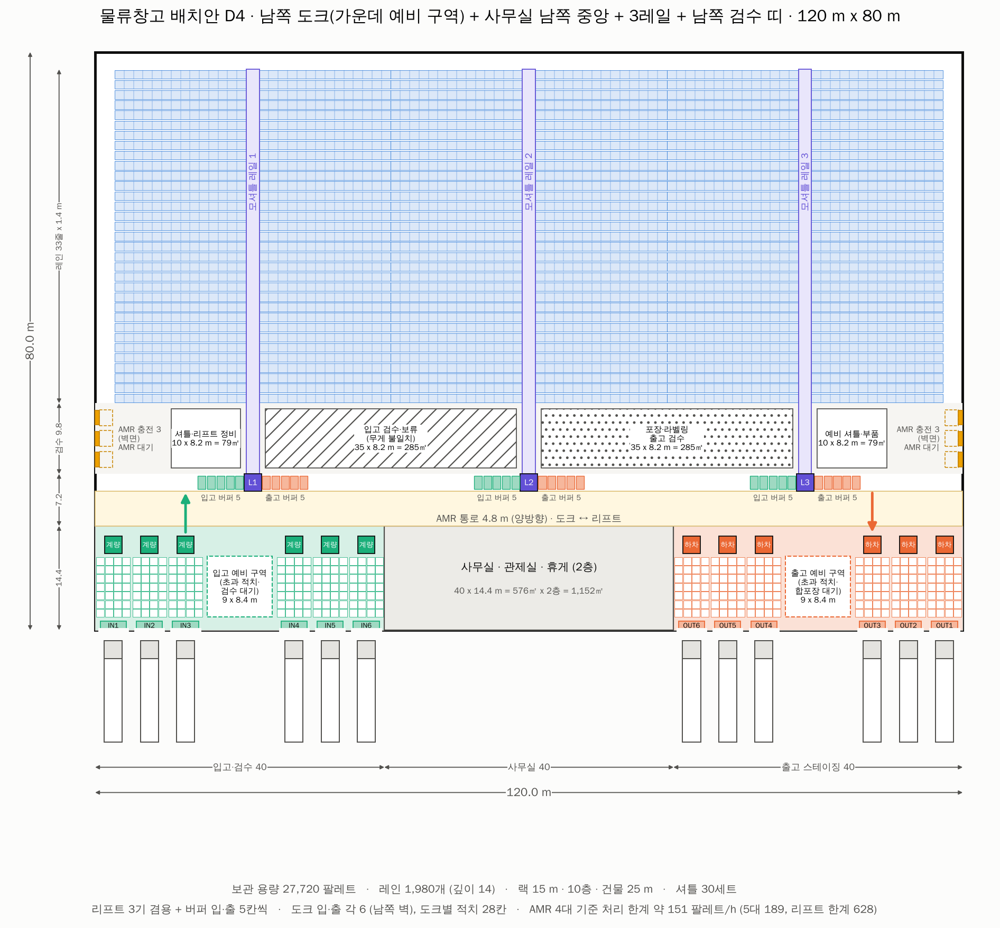
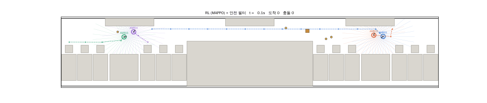
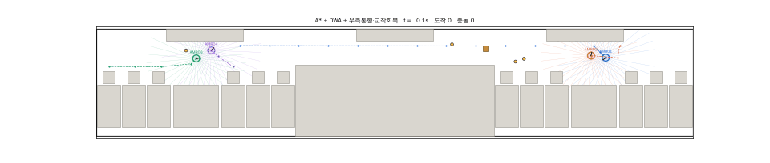

# Fulfillment Algorithm · 물류창고 적재·출고 자동화

120 m × 80 m 물류창고에서 화물을 **어디에 넣고(적재) 어떤 순서로 꺼낼지(출고)** 정하고,
**AMR 4대가 서로 부딪히지 않고** 그 일을 나눠 하도록 만드는 알고리즘·시뮬레이터입니다.
Unity 창고 시뮬레이션, MQTT 장비 통신, 강화학습 AMR 주행까지 한 저장소에서 이어지도록 설계했습니다.

> 포트폴리오 프로젝트입니다. 수요·트럭 도착은 가상 데이터이고, 모든 수치는 이 저장소의 시뮬레이션으로 재현할 수 있습니다.



## 주요 결과

| 영역 | 결과 |
|---|---|
| 적재·출고 (D4, Unity 랙 규칙·장비 속도, 입고·출고 각 40팔레트/h, 8시간 × 3회) | 입고→레인 평균 **17분**, 출고 트럭 도착→상차 완료 평균 **30분**, AMR 충돌 **0건**. 채널 고르기를 회전율·하중 비용식으로 바꾸면 출고 트럭 **23분** |
| 레인 배정 전략 | 무작위 배정 대비 사용 레인 **225개 감소**, 레인 속 빈 칸 **25% → 13%** |
| AMR 작업 배정 | 거리·대기·출고 버퍼 압박을 함께 보는 배정이 단순 선입선출(34분) 대비 출고 리드타임 **22분** |
| MQTT 통신 (실제 Mosquitto 브로커) | 작업 11/11 완료, 메시지 1,855개, **스키마 위반 0건**, 통신 테스트 **18개 통과** |
| AMR 강화학습 vs A* + DWA (작업자·임시 팔레트가 있는 가장 어려운 시나리오) | 처리량 26 → **45건/AMR·h (+72%)**, 정체 100건당 120 → 51. 단, 충돌은 DWA 0 vs RL 33/100건으로 안전은 아직 DWA 우위 → **RL + 규칙 기반 안전 계층** 하이브리드 권장 |
| 전체 테스트 | `python -m pytest -q` → 43개 통과 (Unity C# 상호 운용 테스트 2개는 .NET SDK가 있을 때만 실행) |

| RL MAPPO + 안전 필터 | A* + DWA + 규칙 |
|---|---|
|  |  |

## 창고 설계 (확정 배치 D4)

- 건물 120 × 80 × 25 m, 랙 높이 15 m (10층)
- **셔틀 앤 새틀라이트**형 랙: 레일 3개, 레인 깊이 14 × 33줄 × 10층 = **27,720 팔레트**
- 남쪽 벽 도크: 입고 6(서쪽) · 2층 사무실(가운데) · 출고 6(동쪽), 도크 사이 예비 구역
- 레일 남쪽 끝 리프트 3기, 9.8 m 검수 띠(계량 ±5% 초과 시 QC 보류), 양쪽 벽 충전기 3기씩
- AMR 4대가 도크 ↔ 리프트 버퍼 사이 팔레트 1개씩 운반, 랙 안은 셔틀이 담당
- 통로 방향은 도면에서 고정하지 않고 **시공간 예약 A***로 동적으로 해결

## 시스템 구조

```
 ┌──────────────┐  MQTT (Mosquitto)  ┌───────────────────┐
 │ Unity 시뮬    │ ◀───────────────▶ │ 스케줄러 (warehouse/d4) │  적재·출고, AMR 배정, 시공간 예약
 │ (Mac mini M4) │   pose·scan2d·    └───────────────────┘
 │ 장비 물리·센서 │   cmd/mission·     ┌───────────────────┐
 └──────────────┘   cmd/vel ...     │ AMR 주행 정책 (rl/)   │  RL 추론 (RTX 4060)
                                    └───────────────────┘
                                    ┌───────────────────┐
                                    │ 중앙 관제 (예정)       │  Qwen + LangGraph (NPU)
                                    └───────────────────┘
```

상위 알고리즘이 "누가, 무엇을, 어느 경로·시간대로"를 정하고, RL 정책은 경유점 사이에서 "지도에 없는 장애물을 어떻게 피해 가는지"만 맡습니다.

## 폴더 구조

| 폴더 | 내용 | 상세 |
|---|---|---|
| `warehouse/d4/` | **확정 배치 D4 적재·출고 알고리즘**: 레인 배정, 출고 레인 선택, 1초 단위 통합 시뮬레이션, MQTT 버스 | [docs/algorithm.md](docs/algorithm.md) |
| `warehouse/` | 초기 버전(통로형 4층 랙) 알고리즘: ABC 슬롯팅, 경로 최적화(2-opt, Held-Karp), 다중 AMR 충돌 회피, 하중 센서 반영 | [docs/algorithm.md](docs/algorithm.md) |
| `plans/` | 배치 후보 도면 생성 (D4 = `d_plan.py`) | |
| `experiments/` | 전략·배치·레인 깊이·셔틀 비교 실험 | |
| `unity/` | D4 배치를 Unity 씬 데이터(JSON)로 내보내기 + C# 로더 | [unity/README.md](unity/README.md) |
| `comm/` | MQTT 통신 설계: 토픽 32개, JSON 스키마, 브로커 ACL, Python·Unity C# 클라이언트, 끝에서 끝까지 데모 | [comm/README.md](comm/README.md) |
| `rl/` | AMR 4대 강화학습: PettingZoo 2D 환경, MAPPO/IPPO, A* + DWA 비교, Unity ML-Agents 설계 | [rl/README.md](rl/README.md) |
| `emergency/` | ⏸ **보류** — 비상 대응(화재·랙 붕괴·누액 등) 차단 구역 코드. 현재 범위 밖이라 보관만 함 | [emergency/README.md](emergency/README.md) |
| `tests/` | 알고리즘·D4·RL 테스트 | |
| `out/` | 실험 결과 그림·JSON | |

## 실행 방법

Python 3.10 이상.

```bash
pip install numpy matplotlib pytest                 # 알고리즘
pip install paho-mqtt jsonschema                    # 통신 (+ brew install mosquitto)
pip install torch gymnasium pettingzoo              # 강화학습

python -m pytest -q                                 # 전체 테스트

# D4 적재·출고 전략 비교 → out/d4_compare.png, d4_compare.json, d4_events.json
python -m experiments.d4_compare

# Unity용 배치 데이터 생성 → unity/d4_layout.json
python -m unity.export_d4

# MQTT 끝에서 끝까지 데모 (브로커 자동 실행, 약 25초)
cd comm && python -m sim.run_demo -v && cd ..

# 학습된 RL 정책 평가·데모 (rl/out/run_mappo/last.pt 포함)
python -m rl.evaluate --ckpt "RL MAPPO=rl/out/run_mappo/last.pt" --seeds 20 --out rl/out
python -m rl.demo rl/out/run_mappo/last.pt rl/out
```

RL 학습 명령과 하이퍼파라미터는 [rl/README.md](rl/README.md)에 있습니다.

## 한계와 다음 단계

- 수요·트럭 도착은 파레토 분포 등으로 만든 가상 데이터입니다.
- RL은 CPU 4코어로 2,500만 스텝만 학습한 프로토타입입니다. Unity ML-Agents + RTX 4060으로 학습량을 늘리는 것이 다음 단계입니다.
- 중앙 관제(Qwen + LangGraph)와 센서 기반 돌발 상황 감지는 MQTT 토픽 자리만 잡아 두었습니다.
- 비상 대응은 보류 상태입니다 (`emergency/`).
