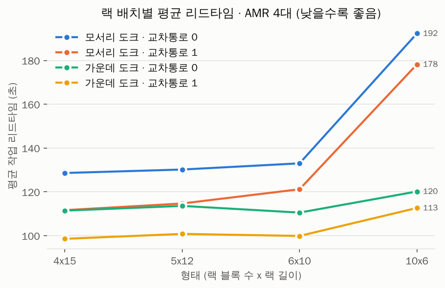
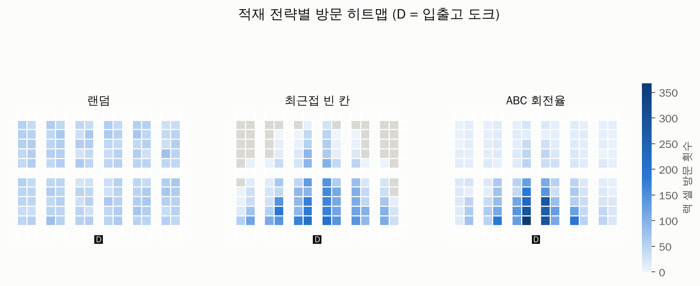
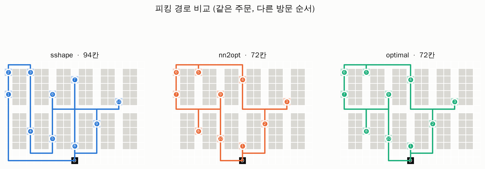
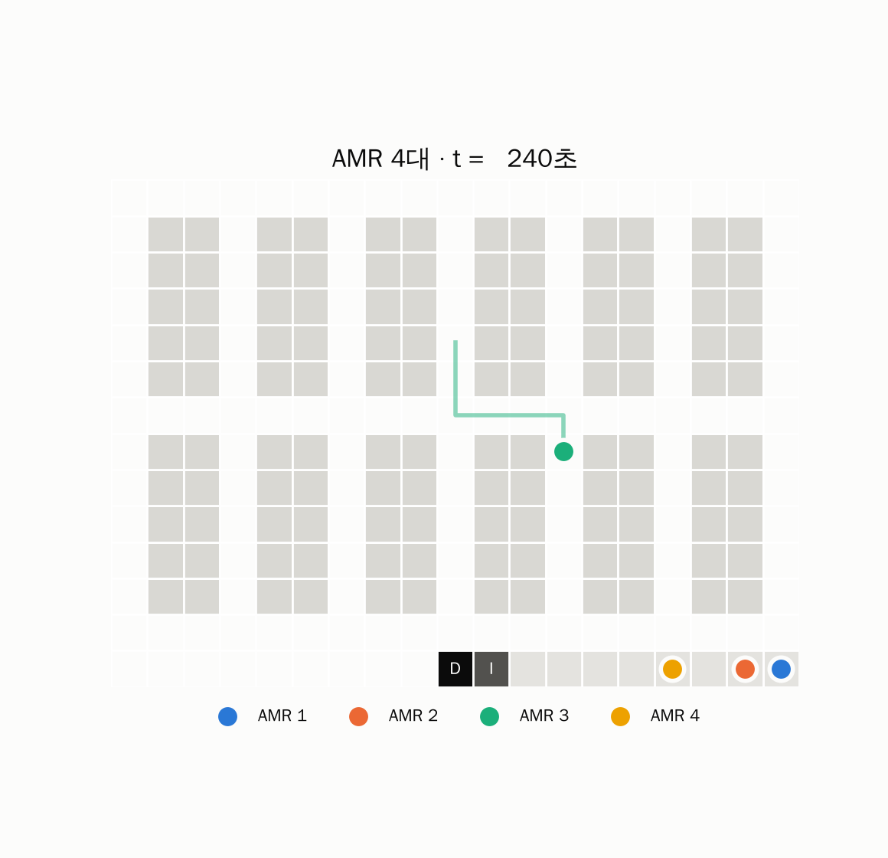
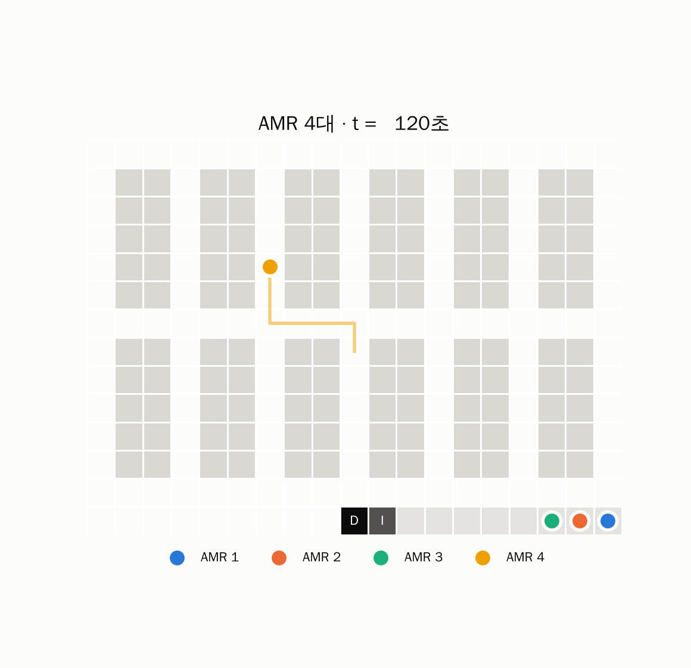
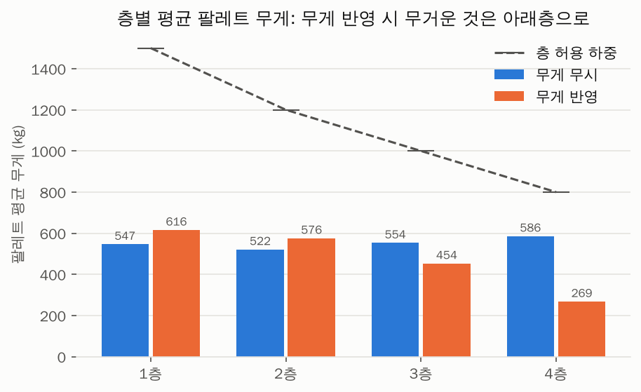

# 물류창고 적재·출고 알고리즘

창고에 들어온 화물을 **어디에 넣을지(적재)**, 주문이 오면 **어떤 화물을 어떤 순서로 꺼낼지(출고)**,
그리고 **AMR 4대가 서로 부딪히지 않고 그 일을 나눠 하도록** 정하는 알고리즘과 시뮬레이터입니다.
Unity 창고 시뮬레이션, 강화학습 AMR 주행, 중앙 관제(LangGraph)와 붙이기 쉬운 구조로 만들었습니다.

```
pip install numpy matplotlib pytest
python -m pytest -q                       # 테스트 11개
python -m experiments.compare out         # 적재·경로·출고 전략 비교
python -m experiments.layout_compare out  # 랙 배치 16종 비교
python -m experiments.fleet_demo out      # AMR 대수, 충돌 회피, 비상 상황 데모
python -m experiments.weight_demo out     # 검수 하중 센서 반영 효과
```

---

## 1. 전체 구조

```
          ┌─────────────── 중앙 관제 (LangGraph) ───────────────┐
          │  센서·카메라 → 비상 감지 → zone_for() → 차단/해제      │
          └──────┬──────────────────────────────────┬──────────┘
                 │                                  │
   계획 계층 (무엇을)                         실행 계층 (누가·언제·어떤 길로)
   Simulator                                  FleetSimulator
   ├ 검수: 하중 센서 → 무게 불일치 보류          ├ 작업 할당: 가장 가까운 유휴 AMR
   ├ 적재 위치: ABC 회전율 + 허용 하중           ├ 충돌 회피: 시공간 예약 + Cooperative A*
   ├ 출고 대상: FIFO / 최근접                   └ 비상 구역: 즉시 재경로, 구역 안 AMR 탈출
   └ 방문 순서: 최근접이웃 + 2-opt / 최적(DP)
                 │                                  │
           SlottingEnv (RL)                  plan_segment → 나중에 RL 주행 정책으로 교체
                 │                                  │
                 └──────── layout.json / tasks.json → Unity ───────┘
```

| 파일 | 역할 |
|---|---|
| `warehouse/layout.py` | 랙·통로 격자, 4층 슬롯, 도크·대기 칸, 허용 하중, Unity 좌표 변환 |
| `warehouse/pathfinding.py` | A* 경로, BFS 거리 캐시 |
| `warehouse/inventory.py` | 재고 상태, 하중 계산, 슬롯 차단 |
| `warehouse/slotting.py` | 적재 위치 전략: 랜덤 / 최근접 / ABC(+무게) |
| `warehouse/routing.py` | 방문 순서: S자 / 최근접이웃+2-opt / Held-Karp 최적 |
| `warehouse/simulator.py` | 입고·검수·적재·출고·재주문 시뮬레이션, Unity 작업 JSON 내보내기 |
| `warehouse/fleet.py` | 다중 AMR 할당, 충돌 회피, 비상 재계획, 충돌 검증 |
| `warehouse/emergency.py` | 화재·랙 붕괴·기울어짐·누액·부상 → 차단 구역 |
| `warehouse/env.py` | 강화학습용 `reset()/step()` 환경 |
| `warehouse/viz.py` | 히트맵, 경로, 비교 차트, AMR 애니메이션 |

## 2. 창고 모델

- 바닥은 1.2m 격자, 랙은 **4층**, 통로 폭 1칸(AMR 1대).
- 앞쪽에 **스테이징 열**(도크 D, 입고 도크 I, AMR 대기 칸 P)을 따로 둬서
  쉬고 있는 AMR이 통로를 막지 않습니다.
- 토트/팔레트 1개 = 슬롯 1개. AMR은 한 번에 최대 6개를 싣고 돕니다.
- 층별 허용 하중 1,500 / 1,200 / 1,000 / 800kg, 랙 한 칸 합계 3,200kg (`layout.py`에서 조정).

## 3. 랙 배치: 추천안은 6×10, 가운데 도크, 중간 교차 통로 1개

슬롯 수(480)를 고정하고 형태 4종 × 도크 위치 2종 × 교차 통로 0/1개 = 16종을 AMR 4대로 돌렸습니다.



- **도크를 앞면 가운데로**: 모서리 대비 평균 리드타임이 형태에 따라 12~38% 줄어듭니다.
- **중간 교차 통로 1개**: 통로 끝까지 가지 않고 옆 통로로 넘어갈 수 있어 추가로 6~11% 줄고,
  비상 시 **우회로·대피로** 역할도 합니다.
- 가운데 도크 + 교차 통로 조합에서는 4×15, 5×12, 6×10이 모두 약 100초로 비슷했고,
  그중 **6×10이 혼잡 대기가 가장 적어서(10.5%, 4×15는 15.2%)** 기본값으로 정했습니다.
  넓고 얕은 10×6은 도크에서 먼 양 끝 통로가 많아 가장 나빴습니다.

## 4. 적재 위치 할당 (Slotting)

| 전략 | 작업 1건당 비용(칸) | 랜덤 대비 |
|---|---|---|
| 랜덤 | 11.54 | 기준 |
| 최근접 빈 칸 | 8.07 | -30% |
| **ABC 회전율 + 구역 내 최근접** | **7.10** | **-38%** |

(경로는 최근접이웃+2-opt, 시드 5개 평균. 비용 = 이동 칸 수 + 층 승강 비용)

**ABC 방식**: 출고 빈도 상위 80%를 차지하는 SKU를 A, 다음 15%를 B, 나머지를 C로 나누고,
도크에서 가까운 슬롯부터 A → B → C 구역으로 배정합니다. 구역이 차면 옆 구역으로 넘칩니다.



## 5. 출고: 어떤 화물을, 어떤 순서로

- **출고 대상**: FIFO(먼저 들어온 것 먼저)가 기본입니다. 가까운 것부터 꺼내면 비용이 10% 줄지만
  오래된 재고가 남으므로, 유통기한이 없는 상품에만 쓰는 옵션으로 두었습니다.
- **방문 순서**: 업계 기본인 S자 대비 최근접이웃 + 2-opt가 약 6% 짧고,
  정확한 최적해(Held-Karp DP)와의 차이는 0.3% 이내입니다.



## 6. AMR 4대: 할당과 충돌 회피

1. **할당**: 대기 중인 작업을 들어온 순서대로, 첫 목적지에 가장 가까운 유휴 AMR에게 줍니다.
2. **충돌 회피**: 시공간 예약표에 이미 계획된 AMR의 (칸, 시각)과 맞교환 이동을 기록하고,
   새 AMR은 (x, y, t) 공간에서 A*로 이를 피해 경로를 짭니다(Cooperative A*). 제자리 대기도 허용합니다.
3. **검증**: 모든 실행 후 같은 칸 동시 점유와 맞교환 충돌을 전수 검사합니다.

| | 충돌 수 | 평균 리드타임 |
|---|---|---|
| 각자 최단경로 | 1,866건 | - |
| **충돌 회피** | **0건** | 100초 (혼잡 대기 +11.2%) |

AMR 대수별 결과 (주문 28.8초마다 1건):

| AMR | 평균 리드타임 | p95 | 가동률 |
|---|---|---|---|
| 2대 | 2,361초 (대기열 폭증) | 4,436초 | 99% |
| 3대 | 125초 | 215초 | 80% |
| **4대** | **100초** | **142초** | **60%** |
| 5대 | 95초 | 124초 | 47% |

4대가 꺾이는 지점입니다. 5대부터는 늘려도 5% 정도만 줄어듭니다.



## 7. 비상 상황

`emergency.zone_for(종류, 위치, layout)`이 차단 구역을 만듭니다.

| 종류 | 차단 반경 | 처리 |
|---|---|---|
| 화재 `fire` | 3칸 | 구역 전면 차단, 해당 슬롯 적재·출고 중지 |
| 랙 무너짐 `rack_collapse` | 2칸 | 낙하물 범위 차단 |
| 랙 기울어짐 `rack_tilt` | 1칸 | 해당 랙 사용 중지 |
| 누수·누액 `leak` | 1칸 | 미끄럼·오염 구역 차단 |
| 사람 부상 `injury` | 2칸 | 구조 인력 동선 확보 |

구역이 생기면
- **실행 계층**: 그 구역을 지나갈 예정이던 AMR만 즉시 멈추고 남은 작업을 우회 경로로 다시 계획합니다.
  구역 안에 있던 AMR은 가장 가까운 안전한 칸으로 먼저 빠져나옵니다. 구역 안 정류장은 건너뛰고 기록합니다.
- **계획 계층**: `Inventory.block_slots()`로 그 구역 슬롯에 새로 넣지 않고, 출고는 다른 위치의 같은 SKU에서 꺼냅니다.
  쓸 수 있는 재고가 부족하면 재입고가 걸립니다.

데모(랙 기울어짐 → 화재): 재계획 후에도 **충돌 0건, 차단 구역 진입 0건**.



LangGraph 관제에서 부를 때는 감지 노드가 `zone_for()`로 구역을 만들고,
실행 노드가 `EmergencyEvent`로 넘기면 됩니다. 반경 같은 기준은 실제 현장 규정에 맞춰 바꾸면 됩니다.

## 8. 검수 하중 센서

검수대에서 팔레트 무게를 재면 세 가지에 씁니다.

1. **송장 무게 불일치 → 보류**: 송장 대비 ±5%를 넘으면 적재하지 않고 보류하고,
   재검수 후 실측 무게로 정정해 입고합니다 (시뮬레이션에서는 2%가 불일치).
2. **허용 하중 제약**: 층 허용 하중과 랙 칸 합계 하중을 넘는 슬롯은 후보에서 뺍니다.
3. **무거운 것은 아래층**: 같은 구역 안에서 `층 × 3 × (무게/1000kg)` 만큼 벌점을 줘서 아래층을 먼저 고릅니다.

| | 허용 하중 초과 적재 | 4층 평균 무게 | 작업 1건당 비용 |
|---|---|---|---|
| 무게 무시 | 90건 | 586kg | 6.91 |
| **무게 반영** | **0건** | **269kg** | 7.10 (+2.7%) |



## 9. 다른 파트와 연결

- **Unity**: `out/layout.json`(격자, 랙, 도크, 대기 칸)과 `out/tasks_sample.json`(작업별 정류장, 웨이포인트, 월드 좌표)을
  그대로 읽으면 됩니다. 좌표는 Unity 관례(y = 높이)로 `to_world()`가 변환합니다.
- **강화학습**:
  - `SlottingEnv`: 적재 위치 결정을 RL로 학습 (관측 = 점유 격자·SKU 순위·무게, 행동 = 슬롯, 보상 = -이동 비용, 하중 위반은 action_mask로 차단).
  - AMR 주행: `fleet.plan_segment`를 학습된 정책으로 바꾸면 할당·비상 처리 로직은 그대로 씁니다.
- **중앙 관제**: `zone_for`, `EmergencyEvent`, `Inventory.block_slots / unblock_slots`, `Simulator.inspect`가 관제 노드에서 부를 훅입니다.

## 10. 한계와 다음 단계

- 통로 폭 1칸 가정입니다. 실제 AMR 크기에 맞춰 통로 폭 2칸(양방향) 버전을 비교해 볼 만합니다.
- 다중 AMR 우선순위는 계획 순서로 정해집니다. 혼잡이 심해지면 CBS(Conflict-Based Search)로 바꿀 수 있습니다.
- 할당은 greedy입니다. 대량 동시 배정이 필요하면 헝가리안 알고리즘으로 바꿀 수 있습니다.
- 수요는 파레토 분포로 만든 가상 데이터입니다.
