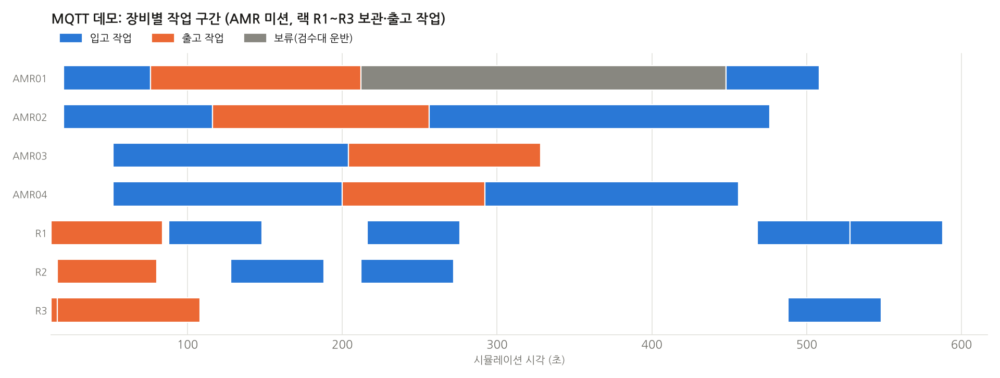
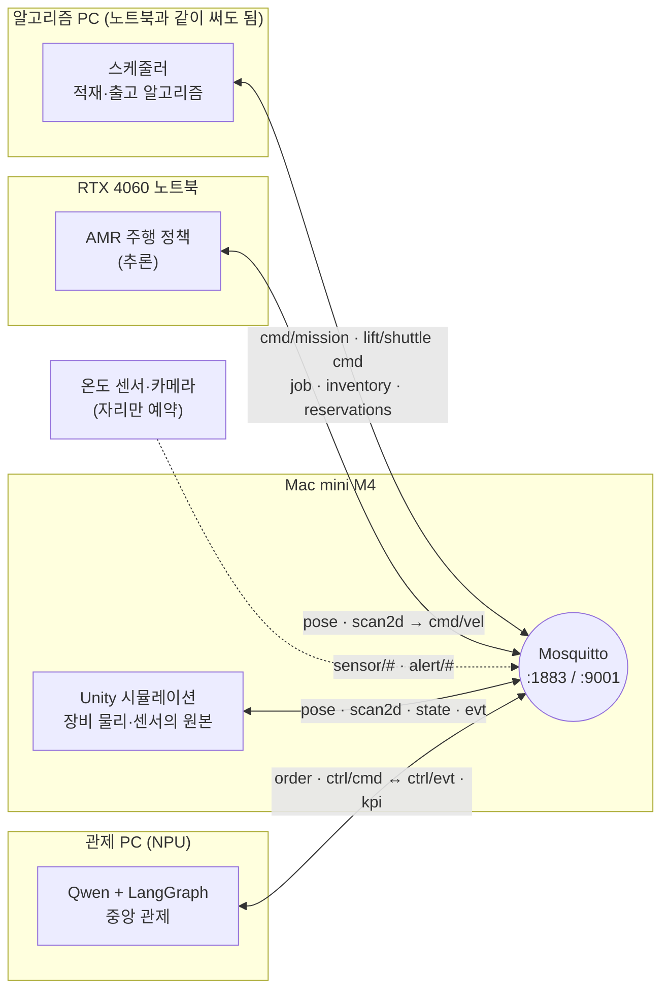
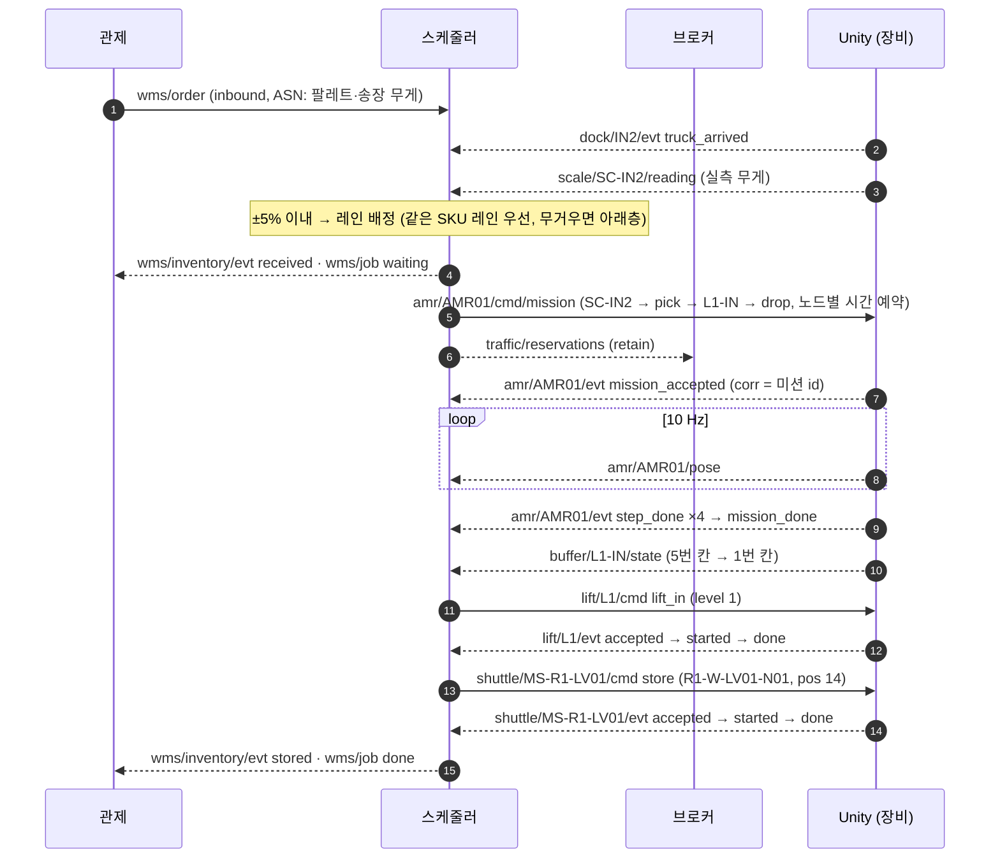
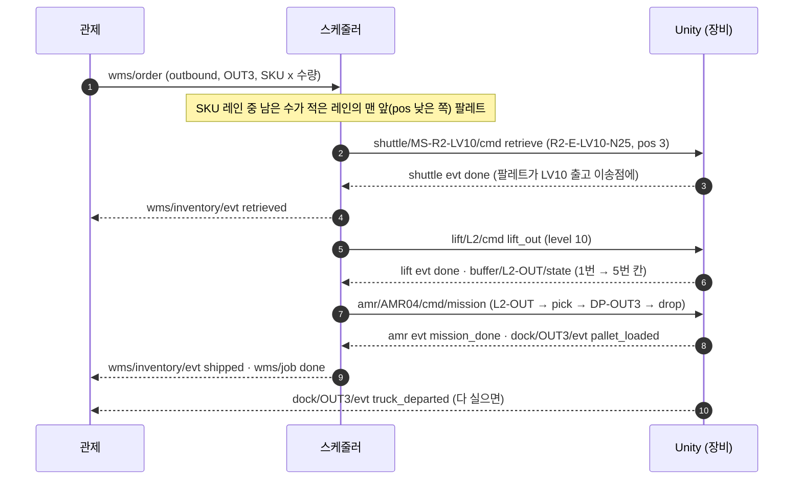
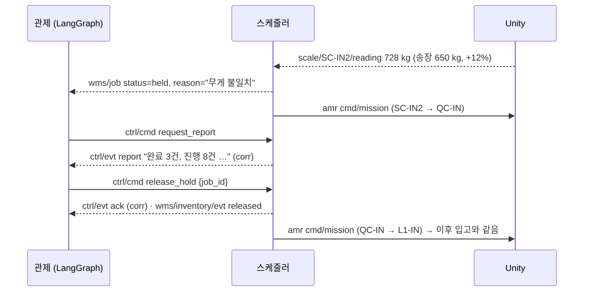
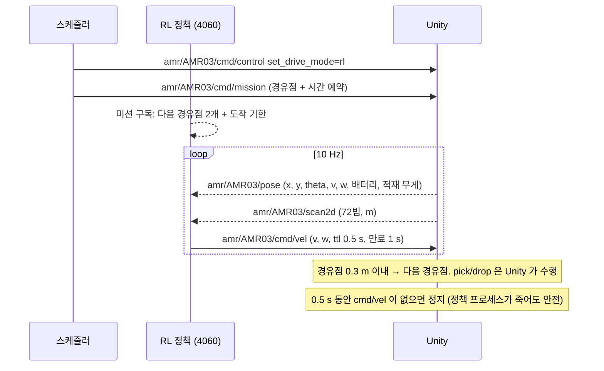
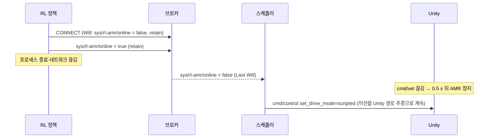

# 장비 간 MQTT 통신 설계 (배치 D4)

Unity 시뮬레이션, 적재·출고 알고리즘(스케줄러), AMR 강화학습 정책, 중앙 관제(LangGraph)가
**Mosquitto 브로커 하나**를 통해 JSON 메시지로 주고받는 구조입니다.
토픽 32개, 메시지 스키마, 브로커 설정·권한, Python 예제(가상 장비 + 스케줄러 브리지), Unity C# 스크립트까지 들어 있고,
끝에서 끝까지 데모가 실제 브로커 위에서 돌아갑니다.

```
pip install paho-mqtt jsonschema matplotlib pytest     # + mosquitto (brew install mosquitto)
python -m sim.run_demo -v          # 브로커를 띄우고 입고 7·출고 4 팔레트를 처리 (약 25초)
python -m pytest -q tests          # 18개 (브로커·ACL·Unity C# 상호 운용·알고리즘 Planner 포함)
```



데모 결과 (30배속, 시뮬레이션 663초, 벽시계 23초): **작업 11/11 완료, 메시지 1,855개, 스키마 위반 0건.**
송장보다 12% 무거운 팔레트 1개는 보류되어 검수대(QC-IN)로 갔고, 관제가 해제 명령을 보내자 다시 레인으로 들어갔습니다.

---

## 1. 전체 구조



| 결정 | 내용 | 이유 |
|---|---|---|
| 브로커 | Mosquitto 2.x, **Mac mini M4** 에서 상시 실행 | 메시지의 70% 이상이 Unity 발행(pose 등)이라 같은 기계에 두면 지연이 가장 적고, 항상 켜 두는 기계라서. 노트북은 절전·이동이 잦음 |
| 프로토콜 | **MQTT v5** | 메시지 만료(Message Expiry)로 늦은 속도 명령을 브로커가 버림, 영구 세션 만료 시간, Content-Type |
| 토픽 | `wh/v1/{장비종류}/{ID}/{채널}` | 장비 종류별 와일드카드 구독(`wh/v1/amr/+/state`), 버전을 토픽에 넣어 v2 와 공존 |
| 본문 | UTF-8 JSON + 공통 봉투 | Unity(Newtonsoft)·Python·LangGraph 모두 바로 읽음. 디버깅이 쉬움 (`mosquitto_sub -v`) |
| 원본 | **Unity = 장비 상태의 원본**, 스케줄러 = 작업·재고의 원본 | 같은 정보를 두 곳이 발행하지 않음 |
| 3D LiDAR | MQTT 로 보내지 않음 | 프레임당 수백 KB. Unity 안(ML-Agents 센서)에서만 사용. 2D LiDAR 72빔만 발행 |
| RL 학습 | ML-Agents 직접 연결, **추론·데모 때만 MQTT** | 학습은 수십 배속 동기 실행이 필요해 브로커를 거치면 느림 (RL 스레드와 합의) |
| 비상 대응 | 토픽·스키마 자리만 예약 (`sensor/#`, `alert/#`) | 현재 범위 밖 |

## 2. 컴퓨터 배치와 네트워크

| 기계 | 역할 (클라이언트 id / 사용자명) | 연결 |
|---|---|---|
| Mac mini M4 | Mosquitto, Unity (`unity-sim` / `unity`) | 유선 LAN, **고정 IP** (공유기 DHCP 예약) |
| RTX 4060 노트북 | RL 추론 (`rl-amr` / `rl`), 스케줄러 (`scheduler` / `scheduler`) | 유선 권장 (Wi-Fi 도 가능, 속도 명령 왕복 수 ms) |
| 관제 PC (NPU) | LangGraph 관제 (`control` / `control`) | LAN |
| 노트북 브라우저 | 대시보드 (`monitor`) | WebSocket :9001 |

- 브로커는 인터넷에 열지 않습니다 (공유기 포트포워딩 없음). 원격에서 볼 때는 VPN(Tailscale 등).
- 지연 예산: pose 발행 → RL 추론 → cmd/vel 수신이 **100 ms(1 제어 주기) 안**. 같은 LAN 이면 MQTT 왕복은 1~5 ms 수준이라
  병목은 정책 추론 시간입니다.

## 3. 이름 규칙

### 장비·위치 ID (Unity 배치 데이터 `unity/d4_layout.json` 과 같음)

| 대상 | 형식 | 예 |
|---|---|---|
| AMR | `AMR01`~`AMR04` | `AMR02` |
| 리프트 | `L1`~`L3` (레일마다 1기) | `L1` |
| 셔틀 세트 (모셔틀 + 세틀라이트) | `MS-R{레일}-LV{층}` | `MS-R1-LV03` |
| 레인 | `R{레일}-{W\|E}-LV{층}-N{줄}` (줄 01 = 남쪽) | `R1-W-LV03-N12` |
| 레인 안 위치 | 1 = 레일 쪽 입·출구 ~ 14 = 벽 쪽 끝 (선입후출) | |
| 층 | 0 = 바닥 P&D(버퍼), 1~10 = LV01~LV10 | |
| 도크 | `IN1`~`IN6`, `OUT1`~`OUT6` | `IN2` |
| AMR 정지점 | 계량대 `SC-IN1~6`, 출고 하차대 `DP-OUT1~6`, 리프트 버퍼 `L1-IN`/`L1-OUT`, 충전기 `CHW1~3`/`CHE1~3`, 검수 `QC-IN`/`QC-OUT` | |
| 버퍼 칸 | 1 = 리프트 바로 옆 ~ 5 = AMR 접점 | |
| 팔레트 | `P` + 8자리 | `P00000003` |

### 좌표

메시지 안 좌표는 모두 **도면 좌표**: 원점 = 건물 남서쪽 바닥 안쪽 모서리, `x` 동쪽(0~120 m), `y` 북쪽(0~80 m), `z` 위.
방향 `theta` 는 동쪽에서 반시계(rad). Unity 로는 `Vector3(x, z, y)`, `yaw = 90° − theta` (`WhCoords.cs`).
AMR 경로의 노드 id 는 `d4_layout.json` 의 `nav` 그래프 노드 그대로입니다 (`n_dock_IN2`, `n_aisle_IN2`, `n_buf_L1-IN` …).

### 시각

봉투의 `t` 는 **시뮬레이션 시각(초)**. Unity 가 `wh/v1/sim/clock` (배속 포함)을 1초마다 retain 으로 발행하고,
다른 클라이언트는 마지막 clock + 벽시계 경과 × 배속으로 현재 시각을 계산합니다 (`WhClient.sim_t`).
시간 예약(`t_start`, `t_end`), `deadline`, `eta` 도 같은 시계입니다. 실제 현장에서는 `t = ts`(벽시계)로 두면 됩니다.

## 4. 메시지 봉투

```json
{
  "v": 1,
  "id": "6f1c2a9e0b7d4c11",
  "ts": 1763461893.125,
  "t": 412.6,
  "src": "scheduler",
  "type": "amr.cmd.mission",
  "corr": null,
  "data": { "mission_id": "M00011", "job_id": "J00009", "priority": 5, "steps": [ ... ] }
}
```

- `id`: 메시지마다 새로. QoS 1 은 중복 도착할 수 있어 받는 쪽이 `id` 로 걸러냅니다 (Python·C# 클라이언트에 구현).
- `corr`: 응답(장비 `evt`, 관제 `ctrl/evt`)이 **어떤 명령에 대한 것인지** 원래 명령의 `id`.
- `type` = 토픽 레지스트리의 key = 스키마 이름. `schemas/{type}.schema.json` 이 봉투까지 포함한 독립 스키마입니다.
- 보내는 쪽은 스키마를 지키고(`additionalProperties: false` 로 검사), 받는 쪽은 모르는 필드를 무시합니다.
  필드 **추가**는 v1 안에서, 삭제·의미 변경은 `wh/v2/` 로.

## 5. QoS · retain · 만료 원칙

| 종류 | QoS | retain | 만료 | 이유 |
|---|---|---|---|---|
| 고빈도 측정 (`pose`, `scan2d`) | 0 | X | 1 s | 10 Hz 로 계속 오므로 하나 잃어도 다음 값이 덮음. 밀린 옛 값은 의미 없음 |
| 속도 명령 (`cmd/vel`) | 0 | X | 1 s + 본문 `ttl` 0.5 s | 늦은 속도 명령은 위험 → 브로커가 버리고, Unity 는 0.5 s 안에 새 명령이 없으면 정지 |
| 명령 (`cmd/mission`, `lift/cmd`, `shuttle/cmd`, `ctrl/cmd`) | 1 | **X** | 30~60 s | 잃으면 안 되지만, retain 하면 재접속 때 옛 명령이 다시 실행됨 |
| 사건 (`evt`, `wms/job`, `wms/inventory/evt`) | 1 | X | | 잃으면 안 됨. 중복은 `id`/`event_id` 로 거름 |
| 상태 (`*/state`, `sim/clock`, `snapshot`, `reservations`) | 1 | **O** | | 늦게 붙은 구독자(재시작한 관제, 새로 켠 대시보드)가 즉시 현재 상태를 받음 |
| 접속 상태 (`sys/{id}/online`) | 1 | O | | Last Will 로 비정상 종료도 표시 |

- QoS 2 는 쓰지 않습니다. 정확히 한 번이 필요한 곳(재고)은 QoS 1 + `event_id` 멱등 처리로 대신합니다.
- 스케줄러·관제는 **영구 세션**(clean start = false, 세션 만료 1시간)으로 접속해, 잠깐 끊긴 동안의 QoS 1 사건을 브로커가 보관합니다.
- 명령의 결과는 반드시 `evt` 로: `accepted` → `started` → `done` / `failed` / `rejected` (`corr` = 명령 id).
  명령을 보낸 쪽은 `accepted` 가 일정 시간 안에 안 오면 장비 `sys/.../online` 과 `state` 를 보고 재발행합니다.

## 6. 토픽

전체 표(발행·구독 역할, 주기, 만료): **[docs/topics.md](docs/topics.md)** · 기계용: [spec/topics.json](spec/topics.json)

| 묶음 | 토픽 (`wh/v1/` 뒤) |
|---|---|
| 시스템 | `sys/{client}/online`, `sim/clock`, `sim/control` |
| AMR | `amr/{amr}/pose`, `scan2d`, `state`, `evt`, `cmd/mission`, `cmd/vel`, `cmd/control` |
| 리프트·셔틀·버퍼 | `lift/{lift}/state·cmd·evt`, `shuttle/{shuttle}/state·cmd·evt`, `buffer/{buffer}/state` |
| 도크·계량·충전 | `dock/{dock}/state·evt`, `scale/{scale}/reading`, `charger/{charger}/state` |
| 스케줄러 | `wms/order`, `wms/job`, `wms/inventory/evt`, `wms/inventory/snapshot`, `traffic/reservations`, `fleet/kpi` |
| 관제 | `ctrl/cmd`, `ctrl/evt` |
| 예약(범위 밖) | `sensor/temp/{sensor}`, `sensor/cam/{camera}/detect`, `alert/{kind}` |

메시지 예시는 [examples/](examples/) (데모 기록에서 type 별로 하나씩 뽑은 실제 메시지).

### AMR 미션 (스케줄러 → Unity, RL)

```json
{"mission_id": "M00011", "job_id": "J00009", "priority": 5, "steps": [
  {"seq": 0, "action": "move", "stop": "SC-IN2", "pallet": null, "theta": -1.5708, "duration": null, "deadline": 90.5,
   "path": [{"node": "n_CHW1",       "x": 1.5, "y": 23.6, "t_start": null,  "t_end": 17.71},
            {"node": "n_jn_CHW1",    "x": 4.5, "y": 23.6, "t_start": 16.21, "t_end": 20.21},
            {"node": "n_aisle_CH_W", "x": 4.5, "y": 16.8, "t_start": 21.88, "t_end": 25.88},
            {"node": "n_aisle_IN2",  "x": 7.5, "y": 16.8, "t_start": 24.38, "t_end": 28.38},
            {"node": "n_dock_IN2",   "x": 7.5, "y": 11.8, "t_start": 28.55, "t_end": 32.55}]},
  {"seq": 1, "action": "pick", "stop": "SC-IN2", "pallet": "P00000001", "path": [], "duration": 8.0, ...},
  {"seq": 2, "action": "move", "stop": "L1-IN", ...},
  {"seq": 3, "action": "drop", "stop": "L1-IN", "pallet": "P00000001", ...}]}
```

- `path` 의 각 노드를 `t_start`~`t_end` 사이에 지나갑니다(그 노드 점유). scripted 주행은 `t_start` 전이면 그 노드 앞에서 기다리고,
  RL 정책은 "다음 경유점 + 그다음 경유점 + 도착 기한(`t_end`)"을 관측으로 씁니다.
- `pick` 은 팔레트가 그 자리에 있을 때, `drop` 은 자리가 비었을 때 시작합니다(전제 조건이 될 때까지 대기).
- 통로 방향은 도면에서 고정하지 않고 이 시간 예약으로 나눠 씁니다. 예약표 전체는 `traffic/reservations` (retain).

## 7. 시퀀스

GitHub 에서는 아래 Mermaid 가 그림으로 보입니다. 같은 그림의 PNG: [docs/diagrams/](docs/diagrams/)

### 입고 (트럭 → 레인)



### 출고 (주문 → 트럭)



### 무게 불일치 보류와 관제 해제



### RL 주행 (추론)



### 접속 끊김



## 8. 대역폭 (실시간 1배속 기준)

데모 기록의 평균 메시지 크기로 계산 (`out/demo_summary.json`).

| 토픽 | 크기 | 빈도 | 합계 |
|---|---|---|---|
| `amr/+/pose` | 220 B | 10 Hz × 4대 | 8.8 KB/s |
| `amr/+/scan2d` (72빔) | 약 620 B | 10 Hz × 4대 | 25 KB/s |
| 그 밖의 상태·사건·명령 | 200~400 B | 합쳐서 수 Hz | 1~3 KB/s |
| **전체** | | | **약 40 KB/s** |

`traffic/reservations`(평균 3.3 KB)와 `wms/inventory/snapshot`(레인 1,980개 다 차면 약 80 KB)이 가장 큰 단일 메시지라
브로커 패킷 한도를 256 KB 로 잡았습니다. 2D LiDAR 를 360빔으로 늘려도 약 120 KB/s 로 LAN 에 부담이 없습니다.

## 9. 보안·권한

- 익명 접속 금지, **사용자명 = 역할** (`unity`, `scheduler`, `rl`, `control`, `sensor`, `monitor`, `admin`).
- ACL([broker/acl](broker/acl))은 토픽 레지스트리의 발행자 정보로 **자동 생성**됩니다. 예: `rl` 은 `amr/+/cmd/vel` 만 쓸 수 있고
  미션은 못 보냄, 모두 자기 클라이언트 id 의 `sys/%c/online` 만 씀(남의 접속 상태 위조 불가).
- `tests/test_broker_acl.py` 가 실제 mosquitto 를 이 설정으로 띄워 틀린 비밀번호 거부, 권한 밖 발행 차단, 접속 상태 위조 차단을 확인합니다.

## 10. 실행

### 브로커 (Mac mini)

```bash
brew install mosquitto
cd comm/broker && ./setup_mac.sh            # 역할별 비밀번호 생성 + 실행 (Ctrl+C 로 중지)
./setup_mac.sh --service                    # 상시 실행 (재부팅 후 자동 시작)
mosquitto_sub -h localhost -u admin -P <비번> -t 'wh/v1/#' -v     # 흐르는 메시지 보기
```

맥이 아닌 곳은 `docker compose up -d` ([broker/docker-compose.yml](broker/docker-compose.yml)).

### Python

```bash
cd comm
python -m sim.run_demo -v                          # 브로커 자동 실행 + 데모 (mosquitto 필요)
python -m sim.run_demo --host 192.168.0.10 --port 1883   # 떠 있는 브로커로
python -m sim.virtual_plant --host <맥IP> --scale 10      # Unity 대신 가상 장비만
python -m sim.scheduler_bridge --host <맥IP>              # 스케줄러만
python -m sim.monitor --host <맥IP>                       # 흐르는 메시지 한 줄씩
python -m whmqtt.export --log out/demo_log.jsonl          # 스키마·토픽 표·ACL·예제 다시 만들기
```

내 코드에서 쓰기:

```python
from whmqtt.client import WhClient
c = WhClient("rl-amr", role="rl", host="192.168.0.10", username="rl", password="...")
c.on("amr.pose", lambda env, p: print(p["amr"], env.data["x"], env.data["y"]))   # p = 토픽 자리 값
c.start()
c.send("amr.cmd.vel", {"v": 0.8, "w": 0.0, "seq": 1, "ttl": 0.5}, "AMR01")      # QoS·만료는 자동
```

### Unity

[unity/WarehouseMqtt/](unity/WarehouseMqtt/) 의 C# 스크립트 5개를 `Assets/Scripts/WarehouseMqtt/` 에 복사합니다.

1. **MQTTnet 4.3.7** (netstandard2.0 DLL) 을 `Assets/Plugins` 에 넣거나 NuGetForUnity 로 설치.
   MQTTnet 5.x 는 Unity 가 지원하지 않는 .NET 버전을 요구하므로 4.3.x 를 씁니다.
2. Package Manager → *Add package by name* → `com.unity.nuget.newtonsoft-json`.
3. 빈 GameObject `MQTT` 에 `WhMqttClient` 를 붙이고 Host(맥 IP 또는 127.0.0.1), username `unity`, 비밀번호 입력.
4. AMR 프리팹에 `AmrMqttAgent` (amrId = AMR01…). 2D LiDAR 는 `Physics.Raycast` 72빔이라 벽·랙에 Collider 가 있어야 합니다.
5. 리프트에 `LiftMqttAgent`, 셔틀 세트에 `ShuttleMqttAgent`. 팔레트 위치(버퍼 칸·이송점·레인)는
   씬의 재고 모델이 `IRackModel` 을 구현해 연결합니다. 계량대·버퍼·하차대는 `IPalletPort` 를 구현해 `AmrMqttAgent.RegisterPort()`.
6. 버퍼·도크·충전기 상태는 값이 바뀔 때 `FacilityMqtt.Buffer(...)`, `FacilityMqtt.Dock(...)` 등을 호출.

| 스크립트 | 내용 |
|---|---|
| `WhMqttClient.cs` | 접속·Last Will·자동 재접속, 받은 메시지를 메인 스레드(Update)로 넘김, QoS 1 중복 제거, `sim/clock` 발행 |
| `WhMessages.cs` | 봉투와 메시지 DTO (필드명 = JSON 키) |
| `WhTopics.cs` | 토픽 문자열, 토픽별 QoS·retain·만료 |
| `WhCoords.cs` | 도면 좌표 ↔ Unity 좌표·회전 |
| `AmrMqttAgent.cs` | AMR: pose·scan2d·state·evt 발행, 미션 수행(scripted), cmd/vel 주행(rl), 0.5 s 무명령 정지 |
| `DeviceMqttAgents.cs` | 리프트·셔틀 명령 큐(FIFO)·evt·state, 버퍼·도크·계량·충전 상태 발행 도우미 |

확인한 것: Unity API 대역(stub)으로 **실제 MQTTnet 4.3.7 + Newtonsoft 13 에 대해 컴파일**,
C# DTO 로 만든 메시지 15종이 Python 스키마를 **전부 통과**, C# 클라이언트가 Python 스케줄러의 미션을 받아 역직렬화하고
응답을 돌려보내는 왕복 (`tools/cs_interop/`). 실제 Unity 에디터에서의 실행은 아직 확인하지 못했습니다.

## 11. 알고리즘과 연결

[sim/scheduler_bridge.py](sim/scheduler_bridge.py) 가 MQTT 와 알고리즘 사이의 다리입니다.
알고리즘 판단은 `Planner` 클래스 세 함수에만 모여 있습니다.

| 함수 | 지금(예제 규칙) | 바꿀 대상 |
|---|---|---|
| `assign_lane(sku, weight, lift_load)` | 같은 SKU 레인 → 빈 레인 중 리프트 가깝고 무거우면 아래층 | 알고리즘 스레드의 레인 할당(ABC·무게) |
| `pick_lane(sku, lift_load)` | 남은 수가 적은 레인의 맨 앞 | 레인 선입후출 출고 규칙 |
| `choose_amr(amrs, src)` | 가장 가까운 유휴 AMR | 할당(헝가리안 등) |

알고리즘 스레드의 구현이 이미 붙어 있습니다: `Scheduler(host, port, planner=D4Planner({}))`
(`warehouse/d4/comm_planner.py`, 층별 허용 하중·회전율·리프트 부하 반영). 이 조합으로도 데모 11/11 완료, 스키마 위반 0건입니다
(`tests/test_e2e.py::test_demo_with_algorithm_planner`).

레인 안 위치(`pos`)는 셔틀에 store 명령을 보내는 순간 정합니다(이미 들어갔거나 들어갈 팔레트 바로 앞 칸).
보류 팔레트처럼 도착 순서가 바뀌어도 세틀라이트가 다른 팔레트를 넘어가지 않게 하기 위해서이고,
가상 장비도 앞에 팔레트가 있으면 store·retrieve 를 실패로 돌려 이를 검사합니다.

AMR 경로·시간 예약은 `Scheduler._mission()` 이 nav 그래프 최단 경로 + 노드 예약 충돌 시 출발 지연으로 만듭니다.
알고리즘의 Cooperative A*(시공간 예약)로 바꾸면 미션의 `path[].t_start/t_end` 에 그대로 들어갑니다.

## 12. 파일

```
comm/
├ README.md               이 문서
├ docs/topics.md          토픽 표 (자동 생성)
├ docs/diagrams/          구조도·시퀀스 다이어그램 PNG
├ spec/topics.json        토픽 레지스트리 (기계용)
├ schemas/                메시지별 JSON Schema 33개 (봉투 포함)
├ examples/               type 별 실제 메시지 예시 32개
├ broker/                 mosquitto.conf, acl(자동 생성), setup_mac.sh, docker-compose.yml
├ whmqtt/                 Python 라이브러리: ids, topics, envelope, schemas, geometry, client, export
├ sim/                    virtual_plant(Unity 대역), scheduler_bridge, monitor, run_demo, timeline
├ unity/WarehouseMqtt/    Unity C# 스크립트 6개
├ tools/                  C# 컴파일·상호 운용 확인 프로젝트
├ tests/                  pytest 18개
└ out/                    demo_log.jsonl, demo_summary.json, demo_timeline.png
```

## 13. 한계와 다음 단계

- 가상 장비(`virtual_plant`)는 AMR 끼리의 물리 충돌을 흉내 내지 않습니다. 충돌 회피는 스케줄러의 노드 시간 예약(교차 이동·간선 충돌은 아직 미검사)과
  RL 정책 몫입니다. 알고리즘의 Cooperative A* 를 붙이면 간선 충돌까지 막힙니다.
- 스케줄러 브리지의 레인·AMR 선택은 예제 규칙입니다 (11장 참고).
- 셔틀의 레인 간 이동(`relocate`)은 스키마만 있고 가상 장비에는 없습니다.
- 브로커 TLS 는 LAN 전용이라 넣지 않았습니다. 외부망에 열게 되면 `listener 8883` + 인증서를 추가하세요.
- 비상 대응(`alert/#`, `sensor/#`)은 자리만 있습니다.
