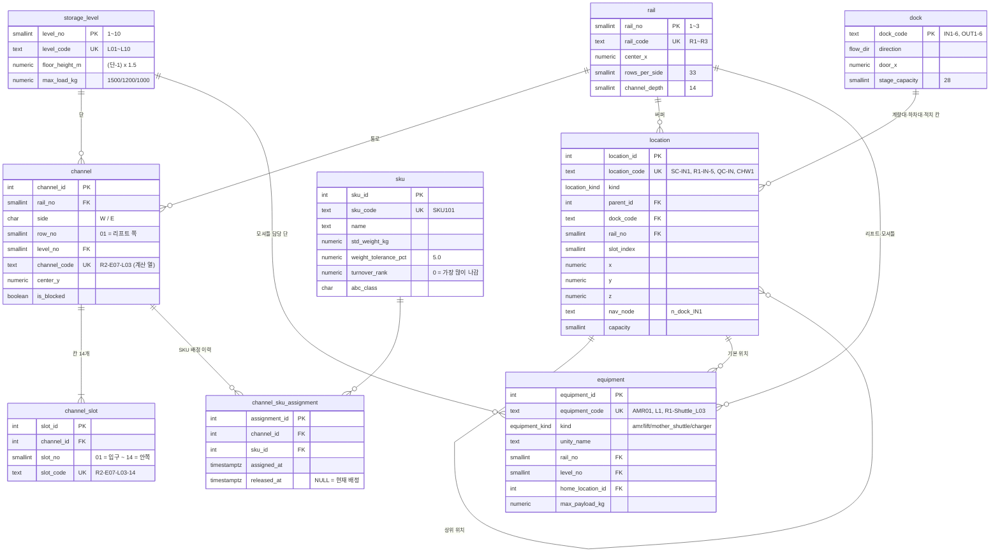
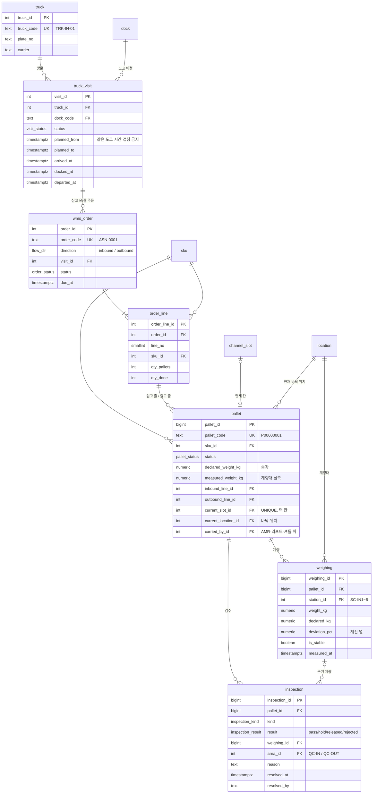
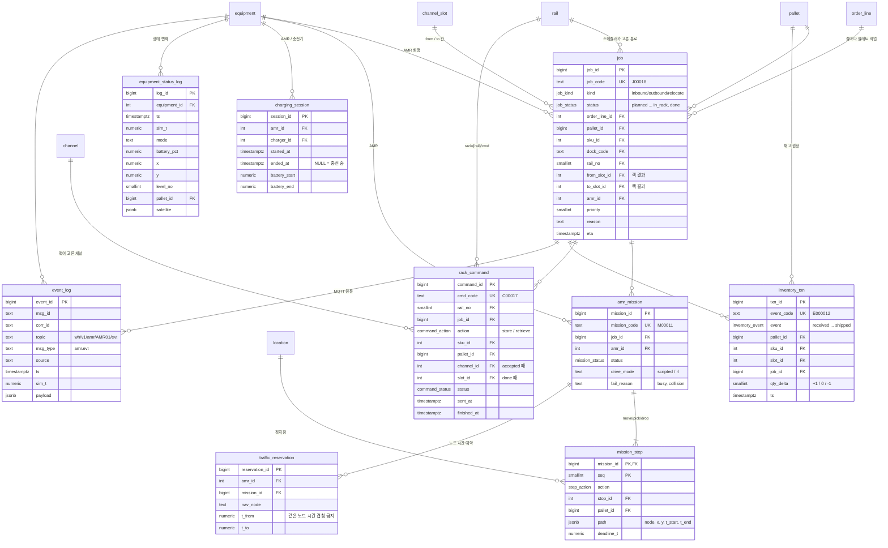

# WMS 데이터베이스 설계 (PostgreSQL, 배치 D4)

창고 관리 시스템(WMS)이 쓰는 PostgreSQL 데이터베이스 설계입니다. 저장소의 실제 코드와 메시지 스키마에서
값과 이름을 가져왔고, 테이블마다 근거를 적었습니다.

| 파일 | 내용 |
|---|---|
| [`01_schema.sql`](01_schema.sql) | 스키마 `wh`: 열거형, 테이블 25개, 규칙 트리거, 조회 뷰 3개 |
| [`02_seed.sql`](02_seed.sql) | 배치 D4 기준 정보: 단 10, 통로 3, 레인(채널) 1,980, 칸 27,720, 도크 12, 바닥 위치 412, 장비 43 |
| [`03_example.sql`](03_example.sql) | 입고 1건 시나리오(`comm/examples`의 ASN-0001)와 규칙 검증 6개. 끝에서 `ROLLBACK` |

```bash
createdb wh
psql -d wh -f docs/database/01_schema.sql
psql -d wh -f docs/database/02_seed.sql
psql -d wh -f docs/database/03_example.sql   # NOTICE "OK ..." 6줄이 나오면 정상
```

PostgreSQL 16.15에서 세 파일을 차례로 실행해 확인했습니다. 확장 `btree_gist`(PostgreSQL 기본 포함)를 씁니다.

---

## 1. 설계 원칙

| 원칙 | 내용 | 근거 |
|---|---|---|
| 원본은 하나 | **장비 상태와 랙 안 채널·칸 선택은 Unity, 작업·주문·통로 선택은 스케줄러.** DB는 스케줄러가 만든 작업과 랙이 알려 준 결과(채널·칸)를 저장하고, 장비 상태는 이력으로만 쌓음 | `docs/unity-interface.md` 3장 |
| 이름은 메시지와 같게 | 상태 값(enum)은 MQTT 스키마의 enum 그대로. 코드 열(`job_code`, `mission_code`, `cmd_code` …)은 메시지의 ID 그대로 | `comm/schemas/*.schema.json` |
| 내부 키와 외부 코드 분리 | 모든 테이블은 숫자 대리키(`*_id`)로 연결하고, 사람이 읽는 코드(`R2-E07-L03`, `AMR01`)는 `UNIQUE` 열로 따로 둠. ID 규칙이 바뀌어도 관계는 그대로 | — |
| 보관 규칙은 DB가 막음 | 레인 1개 = SKU 1종, 칸 1개 = 팔레트 1개, 단 허용 하중, 도크·경로 노드 시간 겹침 금지, 충전기 동시 사용 금지 | `warehouse/d4/storage.py` 머리말, `layout.py` `LEVEL_MAX_KG` |
| 시각 두 개 | 실제 시각 `timestamptz` + 시뮬레이션 초 `sim_t` (MQTT 봉투의 `t`) | `comm/README.md` |
| 고빈도 데이터는 저장 안 함 | AMR pose·LiDAR(10 Hz)는 DB에 넣지 않고, 상태가 바뀔 때(`amr.state` 등)만 기록 | `comm/docs/topics.md` |

---

## 2. ERD

전체를 한 그림에 넣으면 읽기 어려워서 세 묶음으로 나눴습니다. 묶음 사이의 연결은 각 그림 아래에 적었습니다.

### 2.1 배치·기준 정보



### 2.2 주문·트럭·팔레트·검수



`pallet`의 위치는 셋 중 하나만 채웁니다: 랙 칸(`current_slot_id`), 바닥 위치(`current_location_id`), 장비 위(`carried_by_id`). 트럭 위에 있거나 출고된 팔레트는 셋 다 비어 있습니다.

### 2.3 작업·장비 명령·이력



---

## 3. 테이블 설명

### 3.1 배치·기준 정보 (배치가 바뀔 때만 변함)

| 테이블 | 행 수 (D4) | 설명 | 근거 |
|---|---|---|---|
| `storage_level` | 10 | 단. 바닥 높이 (단−1) × 1.5 m, 허용 하중 1~3단 1,500 / 4~6단 1,200 / 7~10단 1,000 kg | `warehouse/d4/layout.py` `LEVEL_MAX_KG` |
| `rail` | 3 | 모셔틀 통로 R1~R3. 중심 x 21.8 / 60.0 / 98.2 | `unity/d4_layout.json` `rails` |
| `channel` | 1,980 | 레인(채널) = 통로 × 면(W/E) × 줄(1~33) × 단(1~10). `channel_code`는 계산 열 `R2-E07-L03` | Unity 명세 6.3장, `storage.py` |
| `channel_slot` | 27,720 | 칸 1~14. 01 = 통로 쪽 입구, 14 = 안쪽. 안쪽부터 채움 | 〃 |
| `channel_sku_assignment` | — | 레인 SKU 배정 이력. 레인이 비고 예약이 0이면 `released_at`을 채워 해제 | `storage.py` `reserve_in` / `commit_out` |
| `sku` | — | 품목. 표준 무게, 무게 허용 오차(±5%), 회전율 순위(`sku_rank`), ABC 등급 | `storage.py` `sku_rank`, `sku_weight` |
| `dock` | 12 | IN1~6, OUT1~6. 적치 칸 28 (4 × 7) | `d4_layout.json` `docks` |
| `location` | 412 | 랙 칸을 뺀 모든 자리. 종류는 아래 표 | `d4_layout.json` |
| `equipment` | 43 | AMR 4, 리프트 3, 모셔틀 30(새틀라이트 탑재), 충전기 6 | 〃 `amrs`, `lifts`, `chargers` |
| `truck` | — | 트럭 | `wms.order.truck` |

`location.kind` 값

| kind | 개수 | 코드 예 | 설명 |
|---|---|---|---|
| `dock_door` | 12 | `IN1`, `OUT1` | 도크 문 |
| `weigh_station` | 6 | `SC-IN1` | 계량대. 입고 AMR이 팔레트를 집는 곳 |
| `drop_stand` | 6 | `DP-OUT1` | 하차대. 출고 AMR이 팔레트를 내려놓는 곳 |
| `stage_slot` | 336 | `IN1-S11` ~ `IN1-S47` | 도크별 적치 칸 28개 (줄·칸 번호, 배치 JSON의 `dock_IN1_stage_11`과 같은 순서) |
| `reserve_area` | 2 | `RESERVE-IN` | 도크 3+3 사이 예비 구역 |
| `buffer` | 6 | `R1-IN`, `R1-OUT` | 리프트 옆 컨베이어 (Unity 위치 문자열과 같음) |
| `buffer_slot` | 30 | `R1-IN-1` ~ `R1-IN-5` | 칸 1 = 리프트 옆, 5 = AMR 접점 |
| `qc_area` | 2 | `QC-IN`, `QC-OUT` | 입고 검수·보류 / 포장·출고 검수 |
| `charger_spot` | 6 | `CHW1`, `CHE1` | 벽면 충전기 앞 AMR 자리 |
| `wait_spot` | 4 | `WAIT1` | AMR 쉬는 자리 |
| `facility` | 2 | `MAINT`, `SPARE` | 셔틀 정비, 예비 부품 |

### 3.2 주문·팔레트·검수

| 테이블 | 설명 | 근거 |
|---|---|---|
| `truck_visit` | 트럭 도착 = 도크 배정. **같은 도크에 예약 시간이 겹치면 거부** (`EXCLUDE USING gist`) | `dock.state`, `dock.evt` |
| `wms_order`, `order_line` | 입고 예정(ASN)·출고 주문과 SKU별 팔레트 수 | `wms.order` (`order_id`, `kind`, `dock`, `truck`, `lines[sku, qty]`, `due`) |
| `pallet` | 팔레트 1개. 송장 무게·실측 무게, 상태, 현재 위치(칸 / 바닥 / 장비 위 중 하나). **한 칸에 팔레트 하나**(`current_slot_id UNIQUE`) | `wms.order.lines[].pallets`, Unity `PalletUnit` |
| `weighing` | 계량대 측정값. 송장 대비 오차 %는 계산 열 `deviation_pct` | `scale.reading` |
| `inspection` | 검수 결과. 입고 무게 불일치(±5% 초과) → `hold`, 관제의 `release_hold` → `released` | `wms.job` held 예제, `ctrl.cmd` |

`pallet.status` 흐름

```
expected ─계량─> received ──> queued(버퍼) ──> in_transit(리프트·셔틀) ──> stored
             └─> held(QC-IN) ─관제 해제─> received
stored ──> picking(셔틀·리프트·AMR) ──> staged(하차대·적치 칸) ──> shipped
```

### 3.3 작업·명령

| 테이블 | 설명 | 근거 |
|---|---|---|
| `job` | 팔레트 1개 단위 작업. 상태 `planned → waiting → amr_assigned → in_rack → done` (+ `held`, `failed`, `canceled`). 스케줄러는 통로(`rail_no`)만 고르고, 칸은 랙 결과로 채움 | `wms.job` |
| `amr_mission`, `mission_step` | AMR 미션과 단계(move/pick/drop). 경로는 메시지의 `path` 배열을 `jsonb`로 그대로 | `amr.cmd.mission`, `amr.evt` |
| `traffic_reservation` | AMR 경로 노드 시간 예약. **같은 노드를 같은 시간에 두 대가 못 씀** | `traffic.reservations`. 통로 방향을 고정하지 않고 시간으로 나눠 쓰는 방식 |
| `rack_command` | 통로 단위 랙 명령 `store`/`retrieve`와 응답(`accepted` 때 채널, `done` 때 칸). 리프트·모셔틀 제어는 Unity `ShuttleRackSystem`이 맡으므로 DB에는 명령을 따로 두지 않고 상태 이력만 남김 | `rack.cmd`, `rack.evt` |
| `charging_session` | AMR 충전 기록. 충전기 하나에 한 대, AMR 하나는 한 곳에서만 | `charger.state` |

### 3.4 이력·로그 (추가만 함)

| 테이블 | 설명 |
|---|---|
| `equipment_status_log` | 장비 상태가 바뀔 때마다 1행 (`amr.state`, 모니터링용 `lift.state`·`shuttle.state`). 모드, 배터리, 위치, 실은 팔레트, 세틀라이트 위치 |
| `inventory_txn` | 재고 원장. `received / held / released / stored / retrieved / shipped / adjusted`. 재고 수량의 근거 (`wms.inventory`) |
| `event_log` | 모든 MQTT 메시지 원문 (봉투 `id`, `corr`, 토픽, `type`, `src`, `data`를 `jsonb`로). 감사·재생용 |

### 3.5 DB가 막는 규칙

| 규칙 | 방법 | `03_example.sql` 검증 |
|---|---|---|
| 레인 1개 = SKU 1종 | 레인당 열린 배정 1개 (`uq_channel_open_assignment`) + 팔레트를 칸에 넣을 때 트리거 `check_pallet_slot`가 SKU 확인 | OK 2개 |
| 단 허용 하중 | 같은 트리거가 실측(없으면 송장) 무게 ≤ `storage_level.max_load_kg` 확인 | OK |
| 칸 1개 = 팔레트 1개 | `pallet.current_slot_id UNIQUE` | — |
| 도크 시간 겹침 금지 | `truck_visit` `EXCLUDE (dock_code =, tstzrange &&)` | OK |
| 경로 노드 시간 겹침 금지 | `traffic_reservation` `EXCLUDE (nav_node =, numrange &&)` | OK |
| 충전기 동시 사용 금지 | 부분 유니크 인덱스 `ended_at IS NULL` | OK |
| 통로·단마다 모셔틀 1대, 통로마다 리프트 1기 | 부분 유니크 인덱스 | — |

### 3.6 뷰

| 뷰 | 내용 |
|---|---|
| `v_channel_stock` | 레인별 SKU·팔레트 수·빈 칸 (= MQTT `rack/{rail}/inventory`의 `channels` 목록) |
| `v_sku_stock` | SKU별 보관·입고 진행·보류 수량, 사용 레인 수 |
| `v_capacity` | 전체 칸 27,720 대비 사용 칸, 사용 레인 |

---

## 4. 열린 문제와 확장

**ID 규칙**: Unity 구현 명세에 맞춘 규칙(2026-11-19, PR #1)을 따릅니다.

| 대상 | 코드 |
|---|---|
| 레인(채널) | `R2-E07-L03` (통로-면·줄-단, 줄 01 = 리프트 쪽) |
| 칸 | `R2-E07-L03-14` (01 = 통로 쪽 입구, 14 = 안쪽) |
| 버퍼 | `R1-IN`, `R1-OUT`, 칸 `R1-IN-1`~`5` (1 = 리프트 쪽) |
| 모셔틀 | `R1-Shuttle_L03` (Unity 씬 이름 `Shuttle_L03` + 통로) |
| 팔레트 | `P` + 8자리(입고 송장) 또는 `R1-000123`(랙 시작 재고). `pallet_code` CHECK로 검사 |

코드는 `UNIQUE` 열일 뿐이고 테이블끼리는 숫자 키로 연결돼 있어, 규칙이 또 바뀌면 `02_seed.sql`의 생성식과 CHECK만 고치면 됩니다.

**출고 도크 번호**: 배치도는 OUT1 = 동쪽 끝(x 117.5)이고 Unity 씬은 반대로 붙어 있습니다(Unity 명세 7장 6번). 이 DB는 배치도 기준입니다.

**데이터가 많아질 때**: `event_log`, `equipment_status_log`, `inventory_txn`은 계속 늘어납니다. 운영 규모가 되면 `ts` 기준 월별 파티션(`PARTITION BY RANGE (ts)`)이나 TimescaleDB 하이퍼테이블로 바꾸는 것을 권합니다.

**비상 대응 (현재 범위 밖)**: 화재·랙 붕괴·랙 기울어짐·누액·작업자 부상은 지금 다루지 않습니다. 확장할 때는
`alert`(종류, 원점 x·y, 반경, 시작·종료, MQTT `alert` 메시지), `alert_zone_channel`(영향 레인 → `channel.is_blocked`),
`sensor`·`sensor_reading`(온도 센서·카메라) 테이블을 추가하면 기존 테이블을 바꾸지 않고 붙일 수 있습니다.
