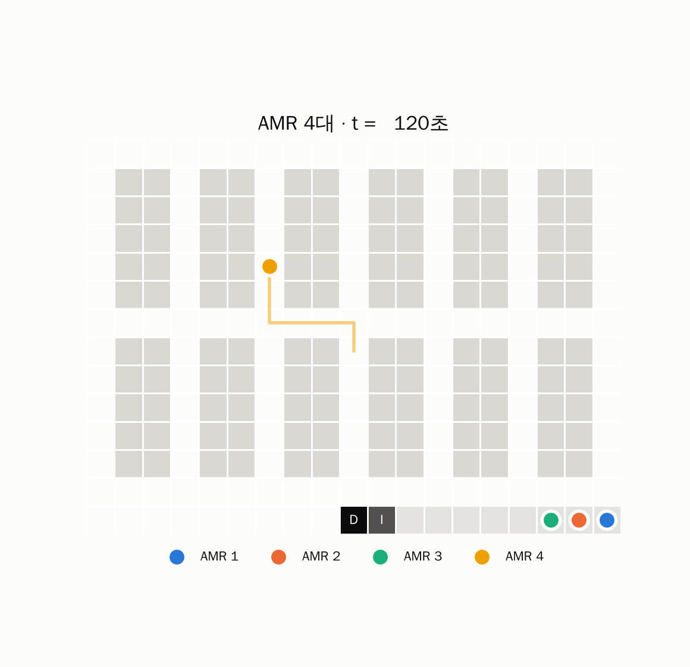

# 비상 대응 (보류)

> **상태: 보류.** 비상 대응은 현재 프로젝트 범위에서 제외되었습니다. 코드는 나중에 다시 쓸 수 있도록 여기에 보관하며,
> 확정 배치 D4 알고리즘(`warehouse/d4/`)에는 아직 연결되어 있지 않습니다. 초기 버전(통로형 랙) 시뮬레이터에서만 동작합니다.

고려했던 위급 상황은 화재, 랙 붕괴, 랙 기울어짐, 상품 누수·누액, 작업자 부상입니다.

| 파일 | 내용 |
|---|---|
| `zones.py` | 비상 종류 + 위치 → 진입 금지 칸·사용 불가 슬롯 (`zone_for`, `Zone`, `RULES`) |
| `tests/test_emergency.py` | 구역 발생 후 AMR이 구역에 들어가지 않는지 검사 |
| `out/fleet_emergency.gif` | 랙 기울어짐 → 화재 데모 (`python -m experiments.fleet_demo out`) |

실행 계층의 재계획 훅(`warehouse.fleet.EmergencyEvent`, `FleetSimulator._on_emergency`)과
계획 계층의 슬롯 차단(`Inventory.block_slots`)은 일반 기능이라 `warehouse/`에 그대로 두었습니다.

```
python -m pytest -q emergency/tests
```

## 설계 메모 (초기 버전 기준)

`emergency.zone_for(종류, 위치, layout)`이 차단 구역을 만듭니다.

| 종류 | 차단 반경 | 처리 |
|---|---|---|
| 화재 `fire` | 3칸 | 구역 전면 차단, 해당 슬롯 적재·출고 중지 |
| 랙 무너짐 `rack_collapse` | 2칸 | 낙하물 범위 차단 |
| 랙 기울어짐 `rack_tilt` | 1칸 | 해당 랙 사용 중지 |
| 누수·누액 `leak` | 1칸 | 미끄럼·오염 구역 차단 |
| 사람 부상 `injury` | 2칸 | 구조 인력 동선 확보 |

구역이 생기면
- **실행 계층**: 그 구역을 지나갈 예정이던 AMR만 즉시 멈추고 남은 작업을 우회 경로로 다시 계획합니다.
  구역 안에 있던 AMR은 가장 가까운 안전한 칸으로 먼저 빠져나옵니다. 구역 안 정류장은 건너뛰고 기록합니다.
- **계획 계층**: `Inventory.block_slots()`로 그 구역 슬롯에 새로 넣지 않고, 출고는 다른 위치의 같은 SKU에서 꺼냅니다.
  쓸 수 있는 재고가 부족하면 재입고가 걸립니다.

데모(랙 기울어짐 → 화재): 재계획 후에도 **충돌 0건, 차단 구역 진입 0건**.



LangGraph 관제에서 부를 때는 감지 노드가 `zone_for()`로 구역을 만들고,
실행 노드가 `EmergencyEvent`로 넘기면 됩니다. 반경 같은 기준은 실제 현장 규정에 맞춰 바꾸면 됩니다.

