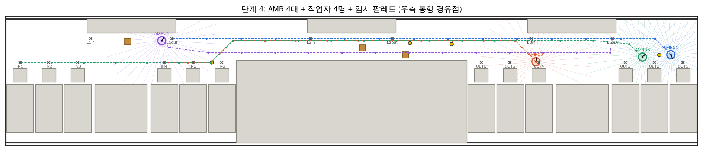
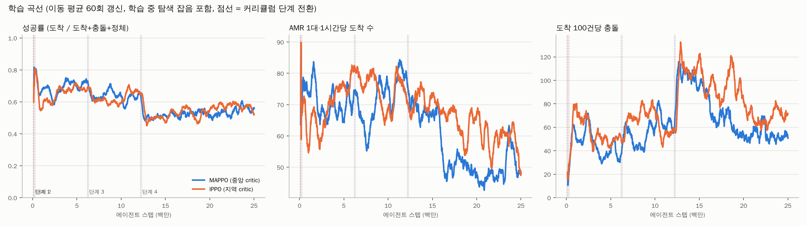
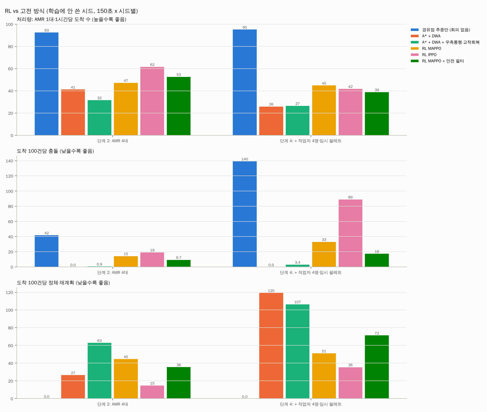
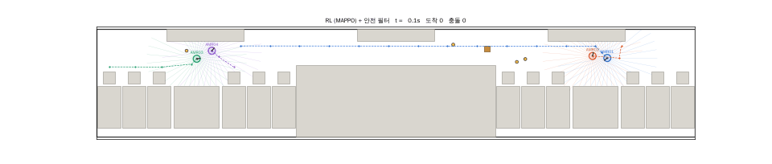
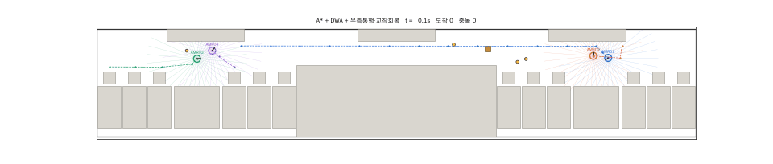

# AMR 4대 강화학습: 환경 설계와 프로토타입

D4 창고에서 AMR 4대가 **도크·계량대 ↔ 리프트 버퍼** 사이를 오가며 서로, 그리고 작업자·임시 팔레트와
부딪히지 않고 빨리 운반하도록 주행 정책을 학습하는 설계입니다.
Unity(ML-Agents) 본 환경을 만들기 전에 같은 관측·행동·보상으로 **Python 2D 프로토타입**을 만들어
학습이 되는지, 고전 방식(A* + DWA)과 비교해 어디가 낫고 어디가 모자란지를 먼저 확인했습니다.

```
pip install -r rl/requirements.txt
python -m rl.mappo --steps 25e6 --stage-max-steps 6e6 --out rl/out/run_mappo                 # MAPPO
python -m rl.mappo --steps 25e6 --stage-max-steps 6e6 --critic local --out rl/out/run_ippo   # IPPO (비교)
python -m rl.evaluate --ckpt "RL MAPPO=rl/out/run_mappo/last.pt" --ckpt "RL IPPO=rl/out/run_ippo/last.pt" \
       --shield "RL MAPPO + 안전 필터=rl/out/run_mappo/last.pt" --seeds 20 --out rl/out
python -m rl.plots rl/out && python -m rl.demo rl/out/run_mappo/last.pt rl/out
```

## 요약

- **환경·학습 파이프라인은 동작합니다.** PettingZoo 표준 API, 커리큘럼 5단계, MAPPO/IPPO 학습, 고전 방식 비교까지 한 번에 돌아갑니다.
- **효율은 RL 이 낫습니다.** 작업자·임시 팔레트가 있는 가장 어려운 시나리오에서 AMR 1대·1시간당 운반이
  A* + DWA 26건 → **RL 45건(+72%)**, 정체(멈춰서 재계획)도 100건당 120 → 51 로 줄었습니다.
- **안전은 아직 DWA 가 낫습니다.** DWA 는 충돌 0 이지만 RL 은 도착 100건당 33건, 안전 필터를 얹어도 18건입니다.
  CPU 4코어로 2,500만 스텝(약 3.5시간)만 학습한 결과라, 이대로 실물·시연에 쓸 수준은 아닙니다.
- **MAPPO(중앙 critic)가 IPPO 보다 혼잡할 때 확실히 안전합니다.** 같은 예산에서 어려운 시나리오의 충돌이 89 → 33.
- 그래서 Unity 쪽 권장 구조는 **"RL 이 경로·속도를 고르고, 규칙 기반 안전 계층이 항상 아래에서 막는" 하이브리드**입니다(9장).

---

## 1. 역할 나누기: RL 은 "어디로"가 아니라 "어떻게 가는지"만

```
 적재·출고 알고리즘 (warehouse/, 상위)        RL 정책 (이 폴더, 하위)              Unity / 실제 AMR
 ┌────────────────────────────┐  경유점·예약 시간  ┌─────────────────────┐   v, w (10 Hz)  ┌─────────┐
 │ 작업 배정, 레인·리프트 선택,   │ ───────────────▶ │ 경유점까지 국소 주행·회피 │ ─────────────▶ │ 차동 구동 │
 │ 시공간 예약, 우측 통행 차선    │  cmd/mission      │ (AMR 마다 같은 신경망)  │  cmd/vel       │         │
 └────────────────────────────┘                   └─────────────────────┘ ◀───────────── └─────────┘
                                                                        pose, scan2d (10 Hz)
```

- 상위 알고리즘이 이미 잘하는 것(누가 어떤 화물을, 어떤 순서로, 어느 차선으로)은 그대로 둡니다.
  RL 이 전역 경로까지 배우면 학습이 수십 배 어려워지고 결과를 설명하기도 어렵습니다.
- RL 은 상위 계획이 모르는 것, 즉 **지도에 없는 장애물(작업자, 임시로 내려놓은 팔레트), 다른 AMR 과의 마주침,
  화물 무게에 따른 가감속**을 처리합니다.
- 통신은 MQTT 설계와 맞췄습니다 (`comm/`): 학습은 ML-Agents 직접 연결, 실행·시연은 MQTT
  `wh/v1/amr/<id>/pose`, `scan2d` → 정책 → `cmd/vel` (만료 0.5 s), 경유점은 `cmd/mission`.

## 2. 환경 범위

AMR 은 랙 안으로 들어가지 않으므로(랙 안은 셔틀 담당) 학습 지도는 **남쪽 운행 구역 120 m × 21.6 m**만 씁니다
(`rl/geometry.py`, 수치는 `plans/d_plan.py` 와 같음).



| 요소 | 내용 |
|---|---|
| 고정 장애물 | 사무실(40~80 m), 도크 적치 차선 12곳, 계량대·하차대, 예비 구역 2곳, 리프트 + 입·출고 버퍼 3곳 |
| 정류장 | 입고 계량대 IN1~6, 출고 하차대 OUT1~6, 리프트 입고 버퍼 끝 L1~3in, 출고 버퍼 끝 L1~3out |
| 임무 | 입고: IN → Lin, 출고: Lout → OUT. 빈 차로 집으러 가는 구간 + 싣고 가는 구간(무게 200~1,500 kg) |
| 상위 경유점 | 고정 장애물만 아는 최단 경로 + **우측 통행 차선**(4.8 m 통로를 동행 y≈15.8 / 서행 y≈17.8 으로 나눔), 1.5~6 m 간격 (`rl/planner.py`) |
| 동적 요소 | 다른 AMR 3대, 작업자(social force 모델: AMR 을 돌아서 걷고, 움직이는 AMR 이 다가오면 멈춰 양보), 임시 팔레트 0~3개(지도에 없음) |
| AMR | 반경 0.7 m (AMR + T11 팔레트 외접원), 최고 1.5 m/s(1,500 kg 이면 1.0), 후진 0.3 m/s, 회전 1.2 rad/s |

## 3. 관측 (AMR 1대 기준, 171차원)

| 항목 | 차원 | 정규화 | 왜 |
|---|---|---|---|
| 2D LiDAR 현재 프레임 | 72 | 거리/10 m | 360°, 5° 간격. 실제 2D LiDAR·MQTT `scan2d` 와 같은 형식 |
| 2D LiDAR 직전 프레임 | 72 | 거리/10 m | 두 프레임 차이로 움직이는 물체의 방향·속도를 알 수 있게 (ML-Agents 의 stack 2) |
| 다음 경유점 | 3 | 거리/10, cos·sin(방위) | 로봇 좌표계. 방위를 cos/sin 으로 줘서 ±180° 경계 불연속 제거 |
| 그다음 경유점 | 3 | 같음 | 코너 전에 미리 감속·조향하도록 |
| 마지막 경유점 여부 | 1 | 0/1 | 도착점에서는 멈춰야 함(0.3 m/s 미만) |
| 자기 속도 v, ω | 2 | /1.5, /1.2 | |
| **화물 무게** | 1 | /1,500 kg | 무거우면 최고 속도·가속이 줄어 제동 거리가 길어짐 → 더 일찍 감속하도록 |
| 직전 행동 | 2 | -1~1 | 부드러운 조작 |
| 가까운 AMR 3대 | 15 | 상대 위치/10, 상대 속도/1.5, 존재 플래그 | MQTT 로 서로의 `pose` 를 공유한다는 가정. LiDAR 만으로는 마주 오는 AMR 의 의도를 알기 늦음 |

**일부러 넣지 않은 것**
- 맞은 물체가 사람인지 팔레트인지(태그). ML-Agents 의 `RayPerceptionSensor` 는 태그 원-핫을 같이 주지만
  실제 LiDAR 는 모릅니다. 그래서 Unity 쪽은 거리만 내는 커스텀 센서(`unity/Lidar2DSensorComponent.cs`)를 씁니다.
- 절대 좌표. 지도를 외워 버리면 배치가 바뀔 때 다시 학습해야 합니다.

**3D LiDAR** 는 2단계로 넣는 걸 권합니다. 2D 스캔 평면(높이 0.25 m)에 안 잡히는 것, 즉 랙·적치대에서 튀어나온 팔레트,
지게차 포크, 바닥에 쓰러진 사람(부상 상황) 때문입니다. 원시 점군을 그대로 넣지 말고, 로봇 주변 8 m × 8 m 를
0.25 m 칸으로 나눈 **높이 격자(32×32×2: 최고 높이, 바닥 아래 0.5 m 안 점 유무)**로 바꿔 작은 CNN 으로 읽습니다.
이때부터 RTX 4060 의 GPU 가 실제로 의미가 생깁니다(9장). 3D 점군은 용량 때문에 MQTT 로 보내지 않고 Unity·로봇 안에서만 씁니다.

## 4. 행동

연속 2차원 `[-1, 1]²` → 목표 선속도 `v = a₀ × v_max` (음수면 `a₀ × 0.3`, 후진은 천천히), 목표 각속도 `ω = a₁ × 1.2`.
실제 속도는 가속 한계(빈 차 1.0 m/s², 1,500 kg 이면 0.6) 안에서 목표를 따라갑니다. 10 Hz.

- 이산 행동(전진/좌회전/…) 대신 연속을 고른 이유: AMR 실제 인터페이스가 `cmd/vel (v, w)` 이고,
  이산으로 하면 도착점 정밀 정지(±0.5 m, 0.3 m/s 미만)에서 덜컹거립니다.
- 목표 속도 + 가속 한계 구조라서 정책이 무리한 값을 내도 물리적으로 가능한 범위 안에서만 움직입니다.

## 5. 보상 (`rl/amr_env.py` `RewardCfg`)

| 항목 | 값 | 설명 |
|---|---|---|
| 진행 | +1.0 / m | 현재 경유점까지 거리가 줄어든 만큼. 촘촘한 신호 |
| 경유점 통과 | +0.5 | 1.2 m 안에 들어오면 다음 경유점으로 |
| 도착 | +10 | 마지막 경유점 0.5 m 안, 속도 0.3 m/s 미만 |
| 충돌 | -30, 생애 종료 | AMR·작업자·고정물. 빈 통로로 다시 배치하고 새 임무 |
| 속도 의존 안전 영역 | -0.3 / m | 정면 ±30° 에서 "정지 거리 + 0.3 m" 안으로 들어온 깊이. 실제 안전 스캐너의 필드 전환을 보상으로 |
| 마주 접근 | -0.3 × (2.2 - 거리) × 접근 속도 | 다른 AMR 중심 거리 2.2 m 안에서 서로 가까워질 때 |
| 근접 | 최대 -0.2 / 스텝 | LiDAR 최소 거리 1.2 m → 0.7 m(접촉) 사이 선형 |
| 작업자 옆 과속 | -0.3 × (v - 0.5) | 작업자 2.5 m 안에서 0.5 m/s 초과분. ISO 3691-4 류의 사람 근처 감속 규칙을 보상으로 |
| 시간 | -0.01 / 스텝 | |
| 막히지 않았는데 멈춤 | -0.02 / 스텝 | 정면 2.5 m 가 비었는데 서 있을 때. 서로 눈치 보며 멈추는 교착 방지 |
| 조작 변화 | -0.02 × ‖Δa‖² | 급조작 방지 (팔레트 흔들림) |
| 정체 | -5 | 한 경유점에 40초 넘게 못 가면 상위 계획기에 재계획 요청 |

설계하며 배운 것 (8장 반복 과정)
- 처음엔 "도착 +10 / 충돌 -15 / 근접 패널티(틈 0.3 m)"만 줬더니, 최고 속도로 마주 지나가며 1.3 m 간격으로 스치는 충돌이 대부분이었습니다.
  드문 종료 보상보다 **위험 상황에서 매 스텝 들어오는 촘촘한 패널티**(안전 영역, 마주 접근)가 훨씬 잘 먹힙니다.
- 충돌을 너무 비싸게만 하면 "아예 안 움직이기"로 수렴합니다. 그래서 "앞이 비었는데 멈춤" 패널티를 짝으로 넣었습니다.
- 처리량(시간당 운반 수)은 개별 보상의 합으로 커집니다. Unity 에서는 MA-POCA 그룹 보상으로
  도착 1건당 +0.1 을 4대 공동으로 줘서 "길 양보"가 손해가 되지 않게 했습니다.

## 6. 다중 에이전트 학습 방식

| 방식 | 구조 | 이 문제에서 |
|---|---|---|
| 독립 학습 (AMR 마다 다른 신경망) | 4개 따로 | AMR 이 같은 기종이라 낭비. 데이터가 1/4 로 쪼개짐 |
| **IPPO** (공유 파라미터 PPO) | actor·critic 모두 자기 관측만 | 단순하고 의외로 강함. 대신 critic 이 남의 상황을 몰라 혼잡할 때 가치 추정이 흔들림 |
| **MAPPO** (공유 actor + 중앙 critic) | actor 는 자기 관측, critic 은 4대 전체 상태 + 작업자 | **프로토타입 기본값.** 학습 때만 전체를 보고 실행은 AMR 마다 독립 |
| **MA-POCA** (ML-Agents 내장) | MAPPO 류 + 에이전트별 기여 추정, 중간에 빠지는 에이전트 처리 | **Unity 기본값.** 충돌로 한 대가 먼저 끝나도 그룹 학습이 안 깨짐 |
| MADDPG / MATD3 | off-policy, 중앙 critic | 연속 행동이지만 하이퍼파라미터에 예민하고 ML-Agents 미지원 |
| QMIX / VDN | 가치 분해 | 이산 행동 전제. 연속 v, w 에 안 맞음 |

고른 이유
1. **같은 기종 4대 → 파라미터 공유.** 한 신경망이 4배 데이터로 배우고, 5대·6대로 늘려도 그대로 씁니다
   (적재·출고 실험에서 5대 이상도 검토했으므로 중요).
2. **중앙 학습, 분산 실행(CTDE).** 실행할 때 각 AMR 은 자기 LiDAR + MQTT 로 받은 이웃 pose 만 쓰니
   통신이 끊겨도 한 대가 멈추지 않고, 학습 때만 critic 이 전체를 봐서 "내가 양보해서 전체가 빨라졌다"를 배웁니다.
   실제로 혼잡한 시나리오에서 IPPO 대비 충돌이 크게 줄었습니다(8장).
3. **on-policy PPO 계열**은 ML-Agents 에서 가장 검증되었고 헤드리스 병렬 수집과 잘 맞습니다.
4. Python 프로토타입은 MAPPO(직접 구현, 구조가 투명), Unity 는 같은 계열인 MA-POCA(설정 파일만으로 가능).
   직접 만든 MAPPO 를 Unity 에 쓰고 싶으면 `mlagents_envs` 의 PettingZoo 래퍼(`UnityParallelEnv`)로 빌드를 감싸
   `rl/amr_env.ParallelAMREnv` 자리에 끼우면 됩니다. 관측·행동 형식을 똑같이 맞춰 둔 이유입니다.

## 7. 커리큘럼

| 단계 | 내용 |
|---|---|
| 0 | 혼자, 빈 통로에서 3~10 m 무작위 목표 |
| 1 | 혼자, 실제 임무(경유점 따라 도크 ↔ 리프트) |
| 2 | 4대 동시 |
| 3 | 4대 + 작업자 2명 |
| 4 | 4대 + 작업자 4명 + 지도에 없는 임시 팔레트 0~3개 (평가 기준 시나리오) |

다음 단계 조건: 최근 150건 이상에서 성공률(도착 / (도착 + 충돌 + 정체)) 85% 이상, **또는 그 단계에서 600만 스텝**.
뒤쪽 조건은 기준을 못 넘어도 마지막 단계까지 학습하도록 넣었습니다(실제로 단계 2~3 은 이 조건으로 넘어감).
처음부터 단계 4 로 학습하면 초반 충돌이 너무 잦아 "멈춰 있기"로 빠지기 쉽습니다.

## 8. 프로토타입 결과

**학습**: MAPPO·IPPO 를 같은 설정·같은 시드로 2,500만 에이전트-스텝(AMR 4대 × 약 174시간 분량의 주행)씩,
CPU 4코어에서 두 개를 동시에 돌려 각 약 3.5시간 걸렸습니다(하나만 돌리면 절반 정도).



**평가**: 학습에 안 쓴 시드 20개 × 150초, 단계 2 와 단계 4. 정책은 탐색 잡음 없이(평균 행동) 실행.
"충돌"은 충돌한 AMR 수(두 대가 부딪히면 2), "정체"는 한 경유점에서 40초 넘게 못 가서 재계획한 횟수입니다.

| 방식 | 단계 2 처리량 (건/AMR·h) | 단계 2 충돌 /100건 | 단계 4 처리량 | 단계 4 충돌 /100건 (AMR쌍·사람·고정물) | 단계 4 정체 /100건 | 단계 4 평균 속도 |
|---|---|---|---|---|---|---|
| 경유점 추종만 (회피 없음) | 92.7 | 42.1 | 95.4 | 139.6 (65·181·133) | 0 | 1.25 m/s |
| A* + DWA | 41.4 | **0** | 26.1 | **0** | 119.5 | 0.41 m/s |
| A* + DWA + 우측통행·교착회복 | 31.8 | 0.9 | 26.7 | 3.4 (1·0·1) | 106.7 | 0.40 m/s |
| RL MAPPO | 47.4 | 14.6 | **45.0** | 33.3 (10·20·10) | **51.3** | 0.67 m/s |
| RL IPPO | **61.8** | 19.4 | 42.0 | 89.3 (27·38·33) | 35.7 | 0.82 m/s |
| RL MAPPO + 안전 필터 | 52.8 | 9.7 | 39.0 | 17.7 (6·4·7) | 71.5 | 0.61 m/s |



| RL MAPPO + 안전 필터 | A* + DWA + 규칙 |
|---|---|
|  |  |

같은 시나리오(단계 4, 시드 1003) 앞 90초, 4배속. 이 시드에서는 RL 이 도착 14건·충돌 0, DWA 가 도착 5건·충돌 0.

**읽는 법**
- **회피 없이 경유점만 따라가면** 빠르지만 150초마다 수십 번 부딪힙니다. 국소 회피가 꼭 필요하다는 기준선입니다.
- **A* + DWA** 는 충돌이 거의 없지만, 장애물을 "멈춰 있다"고 보고 2초 앞만 보기 때문에 마주 오는 AMR·사람 앞에서
  서로 멈춰 버리는 교착이 잦습니다(단계 4 에서 도착 1건당 정체 1.2회). 우측 통행·후진 회복 규칙을 더해도 거의 안 나아졌습니다.
- **RL MAPPO** 는 같은 경유점으로 **처리량 +72%, 정체 -57%** 입니다. 멈추지 않고 비켜 지나가는 법을 배웠기 때문입니다.
  하지만 **충돌이 도착 100건당 33건**으로, 실제로는 쓸 수 없는 수준입니다.
- **안전 필터**(진행 방향 ±40° LiDAR 거리로 "지금 멈춰도 안 닿는" 속도 상한만 거는 규칙, `baselines.SafetyShield`)를 얹으면
  충돌이 절반(17.7)으로 줄고 처리량은 여전히 DWA 의 1.5배입니다. 남은 충돌은 대부분 옆을 스치거나 상대가 다가와 생기는 것이라
  정면 필터로는 못 막습니다.
- **MAPPO vs IPPO**: AMR 만 있을 때(단계 2)는 IPPO 가 더 빠르고 공격적이지만, 사람·팔레트가 섞인 단계 4 에서는
  IPPO 의 충돌이 2.7배입니다. 혼잡할수록 중앙 critic 이 도움이 된다는, 설계에서 기대한 방향과 같습니다.
- 결정 1회 계산: RL 0.03 ms/대, DWA 0.75 ms/대 (CPU). 10 Hz 제어에 둘 다 여유가 크지만 RL 이 25배 가볍습니다.

**거쳐 온 과정** (`out/history/` 에 각 회차 학습 로그)
1. 1차(800만 스텝): AMR 4대 단계에서 성공률 75% 에서 정체, 대부분 AMR 끼리 충돌.
2. 2차(2,500만, 안전 영역 보상 추가): 작업자 단계에서 AMR 들이 서로 마주 보고 멈추는 교착, 사람과 서로 기다리는 교착.
   → 작업자 모델을 social force 로 바꾸고(서 있는 AMR 은 돌아서 감), 상위 계획기에 **우측 통행 차선**을 넣음.
3. 3차: 차선 간격이 1.2 m 라 AMR 지름(1.4 m)보다 좁아 마주 지나갈 때 스침 → 차선 간격 2 m+ 로 넓힘.
4. 4차(위 결과): 마주 접근·근접 패널티 강화, 충돌 -30, 멈춤 패널티, 커리큘럼 5단계.

**이 결과가 말해 주는 것과 한계**
- 학습량이 작습니다. 단계 4 에서 학습은 약 1,300만 스텝, 학습 곡선의 충돌도 아직 내려가는 중이었습니다.
  같은 문제의 공개 사례들은 보통 수억 스텝을 씁니다. Unity + RTX 4060 + 병렬 빌드로 학습량을 늘리는 게 다음 단계입니다.
- 작업자 충돌의 일부는 2D 운동학 모델의 한계(사람이 AMR 옆구리로 걸어오는 경우)입니다. Unity 에서는 사람 애니메이션·회피를 따로 만듭니다.
- 상위 경유점은 시간 예약 없이 최단 경로 + 차선만 줍니다. 실제 시스템은 `warehouse/fleet.py` 의 시공간 예약 경로를 주므로
  마주침 자체가 훨씬 적습니다. 즉 이 결과는 "예약이 깨졌을 때(사람, 지연, 임시 장애물) 얼마나 버티나"에 가깝습니다.

## 9. Unity 로 옮기기

| 파일 | 내용 |
|---|---|
| `unity/AMRAgent.cs` | Agent 뼈대: 관측 27 + LiDAR 센서, 행동 2, 보상, 키보드 Heuristic. 좌표·부호를 Python 과 맞춤 |
| `unity/Lidar2DSensorComponent.cs` | 72빔 거리 전용 커스텀 센서, 프레임 스택 2, 잡음·빔 누락(도메인 무작위화), `scan2d` MQTT 값 노출 |
| `unity/amr_poca_4060.yaml` | `mlagents-learn` 설정 초안 (MA-POCA, 커리큘럼, 도메인 무작위화) |

> 보상 값은 모두 인스펙터에서 바꿀 수 있는 공개 필드입니다. 기본값은 5장 표(4차 학습)와 같습니다.

**권장 구조: RL + 안전 계층.** 8장 결과처럼 학습 정책만으로는 충돌 0 을 보장할 수 없습니다. Unity·실물 모두
`정책 → 안전 필터(속도 상한) → 하드웨어 안전 스캐너(보호 영역 정지)` 순서로 두고, 정책은 효율을, 아래 계층은 안전을 맡깁니다.
안전 인증(ISO 3691-4)은 아래 계층으로 받습니다.

Unity 쪽 에피소드 정의만 조금 다릅니다. Python 은 임무가 끝나도 이어서 다음 임무를 하지만,
ML-Agents 커리큘럼은 "평균 에피소드 보상"으로 단계를 넘기므로 **경로 구간 1개 = 에피소드 1개**로 끊습니다.

**RTX 4060 노트북에서 학습**
- 병목은 GPU 가 아니라 Unity 시뮬레이션입니다. `num_envs` 를 물리 코어 - 2 (8코어면 6)로, `no_graphics: true`,
  `time_scale: 20`. 한 빌드 안에 창고를 2~4개 복제(`num_areas`)하면 프로세스 수를 늘리지 않고 데이터를 더 모읍니다.
- 2D LiDAR + MLP 만 쓰면 CPU 와 GPU 학습 속도가 비슷합니다. 3D LiDAR 높이 격자(CNN)를 넣는 단계부터 `device: cuda` 가 이득입니다.
- 8 GB VRAM 은 이 규모(256×2 MLP, 작은 CNN)에 충분합니다.
- 프로토타입이 2,500만 스텝으로 부족했으므로 Unity 는 3천만 결정부터 시작해 하룻밤 단위로 늘려 보는 걸 권합니다.

**Mac mini M4 에서 시연**
- 학습된 `.onnx` 를 Unity Inference Engine(Sentis)으로 Unity 안에서 돌리거나,
- Python 에서 `torch` 정책을 돌리고 MQTT 로 `cmd/vel` 을 보냅니다. 정책 1회 계산이 0.03 ms 수준이라 10 Hz 에 여유가 큽니다.

**실물로 옮길 때(sim-to-real) 넣어 둔 장치**: LiDAR 잡음 0~3 cm, 빔 누락 0~5%, 행동 지연 0~0.2 s,
화물 무게 200~1,500 kg, 바닥 마찰 0.6~1.0 (YAML `environment_parameters`). 명령이 0.5 s 안에 안 오면 AMR 이 멈추는 건 MQTT 쪽 규칙입니다.

## 10. 고전 방식 비교 실험 계획 (Unity 에서 반복할 것)

| 비교 대상 | 내용 |
|---|---|
| 경유점 추종만 | 회피 없음. 하한선 |
| A* + DWA | 같은 경유점 + Dynamic Window Approach. LiDAR 점을 정지 장애물로 보고 2초 앞을 내다봄. 1.5 m 안에 물체가 있으면 0.6 m/s 로 감속 |
| A* + DWA + 규칙 | 우측 통행(경유점을 오른쪽 0.9 m 로) + 교착 회복(2초 정지 시 1.5초 후진·회전) |
| RL (MAPPO / MA-POCA), RL (IPPO) | 같은 경유점, 같은 관측 |
| RL + 안전 필터 | 위 RL 에 속도 상한 규칙 |

- **같은 조건**: 모두 같은 상위 경유점, 같은 LiDAR, 같은 차량 한계. 학습에 안 쓴 시드 20개 이상 × 150초 × 시나리오별.
- **지표**: 처리량(AMR 1대·1시간당 도착 수), 충돌(100건당, 상대 AMR/사람/고정물로 나눠서), 정체(100건당),
  근접(LiDAR 0.9 m 미만인 시간 비율), 작업자 옆 과속 비율, 평균 속도, 결정 1회 계산 시간.
- **Unity 에서 추가할 시나리오**: 3D 장애물(튀어나온 팔레트, 포크), 통신 지연·끊김, 실제 상위 알고리즘(`warehouse/fleet.py` 시간 예약)과 연결한 하루치 운영,
  AMR 5·6대로 늘렸을 때 재학습 없이 되는지.

## 11. 파일

| 파일 | 내용 |
|---|---|
| `geometry.py` | D4 남쪽 운행 구역 지도, 정류장, 점유 격자 |
| `planner.py` | 상위 계획기 흉내: 정류장별 거리장(Dijkstra) + 우측 통행 차선 + 경유점 |
| `amr_env.py` | 환경 (배열 API + PettingZoo `ParallelAMREnv`), 보상, 커리큘럼 단계, 작업자 모델 |
| `mappo.py` | MAPPO / IPPO 학습기 (프로세스 병렬 수집, GAE, 커리큘럼) |
| `baselines.py` | 경유점 추종, DWA, DWA + 규칙, RL 용 안전 필터 |
| `evaluate.py`, `plots.py`, `demo.py`, `render.py` | 평가, 그림, 애니메이션 |
| `out/run_mappo`, `out/run_ippo` | 최종 학습 로그·가중치(`last.pt`) |
| `unity/` | ML-Agents YAML, C# 뼈대 |
